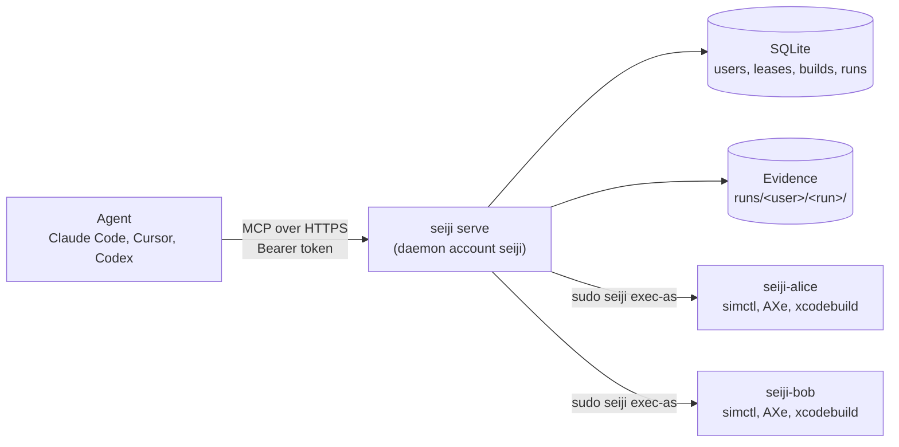

<p align="center">
  <picture>
    <source media="(prefers-color-scheme: dark)" srcset="assets/logo-dark.svg">
    
  </picture>
</p>

Seiji lends iOS simulators on one shared Mac to AI coding agents, and records evidence of everything they do on them. An agent connects over MCP, boots a fresh simulator, installs its build, runs a sequence of steps or its XCUITest suite, and gets back a video, the app's logs, crash reports, a screenshot of every step and a manifest with a SHA-256 for every file. Seiji gives each person a token and a budget, and it keeps each person's devices, files and processes apart.

Seiji is for a team that rents one Mac, for example an AWS EC2 `mac-m4max.metal`, and shares it among a fixed number of people with fair limits. Android emulators work for the basics (lease, install, Maestro flows); the evidence tools are iOS-only for now.

## Design

- A **lease** is one person's hold on one device. Each lease gets a new simulator. At release, Seiji deletes it, so nothing survives into the next lease.
- Every minute that a lease exists counts against the person's monthly **budget**. A device that fails to boot costs nothing. Before Seiji boots a device, it checks the budget, the person's concurrency limit and the host capacity in one atomic step. A reaper releases a device when its lease goes idle, runs too long, or uses up the budget.
- A **run** is one recorded execution on a lease: `run_actions` (steps driven through the accessibility tree), `run_xctest` (a compiled XCUITest bundle) or `run_flow` (Maestro YAML). Around every run Seiji records the screen, streams the app's log and collects crash reports. The **evidence** outlives the lease, belongs to its owner, and expires after a retention period.
- The iOS tooling is native: `xcrun simctl` for screenshots, video, logs, status bar, permissions, location and push; `xcodebuild` and `xcresulttool` for XCUITest. [AXe](https://github.com/cameroncooke/AXe) sends taps, typing and gestures and reads the accessibility tree.
- With `os_user` isolation each person has their own macOS account. The daemon has no privileges. It runs device commands as that account through two small root helpers that sudoers allows, and nothing else.

## Capabilities

| Area | Features |
|---|---|
| Devices | A fresh iOS simulator (or Android emulator) for each lease, models you choose in the config |
| Recorded runs | `run_actions` (tap, type, swipe, scroll, button, key, `wait_for`, `assert_visible`, `assert_not_visible`, `screenshot`, `capture_tree`, `open_url`, `launch_app`, `terminate_app`, `sleep`), `run_xctest` (`test-without-building`, keeps the `.xcresult`), `run_flow` (Maestro) |
| Evidence | Video, app log, crash reports, a screenshot per step, the accessibility tree at a failure, per-test results, a manifest with SHA-256s, a Markdown summary for pull requests, `evidence.zip`. Secret text is redacted |
| Device control | Install, launch, terminate, uninstall, open URLs, fixed status bar, light or dark mode, simulated location, privacy permissions, push notifications, recent logs |
| Viewer | Watch a lease's iOS simulator live in a browser or in Tern, and tap, swipe and type on it. Agents share one-time viewer links with `share_screen` |
| Agent interface | Remote MCP over Streamable HTTP with a bearer token (23 tools); file downloads under `/v1/runs/` |
| Budgets | Seats, device-minutes per month, devices at the same time, maximum lease length, idle release, evidence bytes per user, an estimate in US dollars |
| Isolation | One macOS account for each person (`os_user`), or one shared account (`shared`) |
| Administration | `seiji user` (add, set quota, disable, rotate token, remove), `seiji usage` per month, `seiji doctor` checks the host end to end. On a developer's Mac, `seiji login` keeps the token in the keychain |
| Operation | One binary, SQLite ledger, launchd service, recovery after a restart |

## How it works



1. An agent calls `acquire_device`. Seiji checks the budget, the concurrency limit and the host capacity, then boots a new simulator as the person's macOS account.
2. The agent uploads its build, calls `install_app`, and optionally `configure_device` for a clean status bar, dark mode, a location or permissions.
3. The agent calls `inspect_screen` to read the accessibility tree, then `run_actions` with its steps, or `run_xctest` with its test bundle.
4. Seiji returns the run's verdict and a `run_id`. The agent calls `export_evidence` for a Markdown summary with links to the video, the log and `evidence.zip`, and pastes it into the pull request.
5. The agent calls `release_device`. If it forgets, the reaper releases the device when it goes idle. The evidence stays for `evidence.retentionHours`.

[docs/architecture.md](docs/architecture.md) has the full diagrams.

## Quick start: one Mac in shared mode

Shared mode runs everything as your own account. Use it to try Seiji on a laptop or to develop it.

> **Warning:** In shared mode, everything a run executes runs as your account and can read your files. Use `os_user` isolation on a shared host. See [docs/security.md](docs/security.md).

You need macOS with Xcode and an iOS simulator runtime, Rust 1.88 or later, and AXe (`brew install cameroncooke/axe/axe`). Maestro is optional.

1. Get the code:
   ```sh
   git clone https://github.com/wiljafor1/seiji && cd seiji
   ```
2. Build:
   ```sh
   cargo build --release
   ```
3. Write `seiji.json`. Change the runtime to one that `xcrun simctl list runtimes` shows:
   ```json
   {
     "dataDir": "./data",
     "seats": 3,
     "capacity": { "ios": 2, "android": 0 },
     "defaultQuota": { "monthlyMinutes": 600, "maxConcurrent": 1, "maxLeaseMinutes": 60, "idleMinutes": 15 },
     "isolation": { "mode": "shared" },
     "ios": {
       "models": { "iphone-16": { "deviceType": "com.apple.CoreSimulator.SimDeviceType.iPhone-16", "runtime": "com.apple.CoreSimulator.SimRuntime.iOS-18-5" } },
       "defaultModel": "iphone-16"
     }
   }
   ```
4. Add a user. The command prints the token once. Keep it.
   ```sh
   ./target/release/seiji user -c seiji.json add alice
   ```
5. Check the host end to end. This boots a simulator, reads its accessibility tree, records 3 s of video and log, and deletes it:
   ```sh
   ./target/release/seiji doctor -c seiji.json alice
   ```
6. Start the server:
   ```sh
   ./target/release/seiji serve -c seiji.json
   ```
7. Connect an agent. For Claude Code:
   ```sh
   claude mcp add --transport http seiji http://127.0.0.1:4780/mcp --header "Authorization: Bearer sj_..."
   ```
8. Ask the agent to boot an iPhone, install your app, test the login screen, and give you the evidence for the pull request.

## Quick start: EC2 Mac with one account for each person

[docs/install.md](docs/install.md) gives every step. In short:

1. Prepare the host: Xcode, an iOS runtime and AXe; optionally Maestro and the Android SDK.
2. Install the binary as root, so that the daemon cannot change it:
   ```sh
   sudo install -o root -g wheel -m 755 target/release/seiji /usr/local/bin/seiji
   ```
3. Make the daemon account `seiji`, the data directory and `/usr/local/etc/seiji/seiji.json` (start from [deploy/seiji.example.json](deploy/seiji.example.json)).
4. Install the sudoers rule:
   ```sh
   sudo visudo -cf deploy/sudoers.seiji && sudo install -m 440 deploy/sudoers.seiji /etc/sudoers.d/seiji
   ```
5. For each person, make the macOS account, the Seiji user, and check them:
   ```sh
   sudo seiji tenant provision alice -c /usr/local/etc/seiji/seiji.json
   sudo -u seiji seiji user add alice
   sudo -u seiji seiji doctor alice
   ```
6. Start the service with [deploy/dev.seiji.daemon.plist](deploy/dev.seiji.daemon.plist), put a TLS proxy in front, and set `listen.publicUrl` so download links in tool results are absolute.

> **Status:** Running `simctl`, AXe and `recordVideo` for a macOS account that never logged in to the GUI, through `launchctl asuser`, is not yet verified on a real EC2 host. `seiji doctor <user>` is the test. If it fails, set `isolation.mode` to `"shared"`. Then all people share the daemon account, and Seiji keeps them apart only through their tokens.

## Watch and drive the simulator in Tern

The Seiji plugin for [Tern](https://tern.sh) desktop shows your budget, your devices and your runs in a panel. It opens a device's screen in the viewer, in Tern's browser beside the panel, where you watch it live and tap, swipe and type on it. The viewer works on iOS simulators only. From a clone of this repository, install the `seiji` CLI and the plugin on your Mac, then sign in with your token:

```sh
cargo install --path .
tern plugin link tern-plugin
seiji login --url https://seiji.example.com
```

[docs/tern.md](docs/tern.md) covers the panel, the keys and the limits.

## Documentation

[docs/index.md](docs/index.md) is the map of all documents. The main ones:

| Document | Content |
|---|---|
| [Concepts](docs/concepts.md) | Users, leases, devices, budgets, capacity, the reaper, runs and evidence, isolation |
| [Architecture](docs/architecture.md) | Components, privilege chain, sequence diagrams, data model, design decisions |
| [Install](docs/install.md) | EC2 Mac, accounts, sudoers, launchd, TLS, agent setup |
| [Configuration](docs/configuration.md) | Every key of `seiji.json` |
| [MCP and HTTP API](docs/mcp.md) | Tools, the actions reference, results, errors, uploads and downloads, viewer links |
| [Tern](docs/tern.md) | The Tern plugin and the viewer |
| [CLI](docs/cli.md) | The `seiji` command |
| [Security](docs/security.md) | Trust boundaries, root helpers, evidence handling, file permissions, known limits |
| [Troubleshooting](docs/troubleshooting.md) | Symptoms, checks and fixes |
| [Testing](docs/testing.md) | Test suite and host checks |
| [Glossary](docs/glossary.md) | Terms |

To contribute, read [CONTRIBUTING.md](CONTRIBUTING.md) and [AGENTS.md](AGENTS.md). To report a vulnerability, read [SECURITY.md](SECURITY.md).

## License

Seiji is available under the [MIT License](LICENSE).
