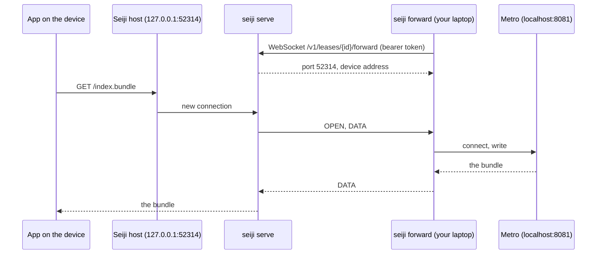

# Testing your app

This guide shows how to get your app onto a Seiji device. There are two ways. Install a build: the app carries its own JavaScript bundle and needs nothing from your machine. Or run your dev server: the app loads its code from Metro on your laptop, through `seiji forward`.

## Contents

- [Which way](#which-way)
- [Install a build](#install-a-build)
- [Run your dev server with `seiji forward`](#run-your-dev-server-with-seiji-forward)
- [Expo Go](#expo-go)
- [Expo development build](#expo-development-build)
- [React Native without Expo](#react-native-without-expo)
- [Android](#android)
- [Several apps at once](#several-apps-at-once)
- [Other dev servers](#other-dev-servers)
- [How the tunnel works](#how-the-tunnel-works)
- [Limits](#limits)

## Which way

| You want | Use |
|---|---|
| Agents testing a pull request, runs with evidence, CI | [A build](#install-a-build). Nothing depends on your laptop. |
| To try changes as you type, with Fast Refresh | [`seiji forward`](#run-your-dev-server-with-seiji-forward) and your dev server. |
| A quick look with Expo Go, no native code of your own | [Expo Go](#expo-go) and `seiji forward --expo-go`. |

## Install a build

`install_app` installs an archive that you uploaded, or one at an https URL. On iOS the archive is a `.zip` or `.tar.gz` holding a **simulator** `.app` (a device `.ipa` does not run on a simulator). The build's architecture must match the host: `arm64` on Apple silicon (EC2 `mac2` instances), `x86_64` on Intel (`mac1`). On Android it is an `.apk`.

Make the archive:

```sh
# Expo, with EAS: in eas.json, give the profile "ios": { "simulator": true }
eas build --profile preview --platform ios        # downloads a .tar.gz

# Expo, locally
npx expo run:ios --configuration Release
ditto -c -k --keepParent ios/build/Build/Products/Release-iphonesimulator/MyApp.app MyApp.zip

# React Native or native iOS
xcodebuild -workspace ios/MyApp.xcworkspace -scheme MyApp -configuration Release \
  -sdk iphonesimulator -derivedDataPath build
ditto -c -k --keepParent build/Build/Products/Release-iphonesimulator/MyApp.app MyApp.zip
```

Upload it and install it:

```sh
curl -H "Authorization: Bearer $(seiji token print)" -H "X-Filename: MyApp.zip" \
  --data-binary @MyApp.zip https://seiji.example.com/v1/apps
# {"app_id": "a_…", "filename": "MyApp.zip", "size": …}
```

Then ask the agent to call `install_app` with that `app_id`, or with the https URL of a build that already lives somewhere (an EAS artifact, a CI artifact, a GitHub release). Seiji keeps an upload for `appRetentionHours` (72 h by default), so one upload serves many leases. For the limits, read [mcp.md](mcp.md#post-v1apps).

## Run your dev server with `seiji forward`

The device runs on the Seiji host. There, `127.0.0.1:8081` is the host itself, not your laptop. `seiji forward` closes that gap:

```sh
npx expo start                 # or: npx react-native start; Metro listens on 8081
seiji forward 8081             # in another terminal, while you hold a device
```

```text
Forwarding l_4cfb333bdd6b: the device reaches localhost:8081 at 127.0.0.1:52314
  Expo Go:      exp://127.0.0.1:52314
  Dev build:    <scheme>://expo-development-client/?url=http%3A%2F%2F127.0.0.1%3A52314
  React Native: seiji forward 8081 --react-native [BUNDLE_ID]
Ctrl-C stops.
```

The device now reaches your Metro at the address it printed. Every connection carries over, the bundle and the WebSockets of Fast Refresh and the debugger alike. The port on the host is new for each tunnel, so start `seiji forward` again after a restart and use the new address.

| Option | What it does |
|---|---|
| `PORT` | The port on your machine (default `8081`). |
| `--lease ID` | Which device. Without it, the one device you hold. |
| `--expo-go` | Then opens `exp://<address>` on the device. |
| `--dev-client SCHEME` | Then opens the address in your Expo development build. |
| `--react-native [BUNDLE_ID]` | Then points a React Native debug build at the address and relaunches it. Without a bundle id: the app installed last. |

The tunnel ends on Ctrl-C, when the lease ends, or when the server stops. While it is open, it counts as activity on the lease, so the device is not released for idling.

## Expo Go

Install Expo Go on the simulator once per lease, from Expo's release, then open your project in it:

```text
install_app {"url": "https://github.com/expo/expo-go-releases/releases/download/Expo-Go-58.0.7/Expo-Go-58.0.7.tar.gz"}
```

```sh
npx expo start
seiji forward 8081 --expo-go
```

Take the Expo Go version that matches your project's SDK. `https://api.expo.dev/v2/versions/latest` lists the `iosClientUrl` of each SDK.

## Expo development build

Build the development client for the simulator once (`eas build --profile development --platform ios` with `"ios": { "simulator": true }`), and install it with `install_app`. Then:

```sh
npx expo start --dev-client
seiji forward 8081 --dev-client exp+my-app
```

The scheme is `scheme` in your `app.json`, or `exp+<slug>` when you set none. `npx uri-scheme list` in the project prints it.

## React Native without Expo

Install a **Debug** simulator build (the Release one carries its bundle). A debug build looks for Metro at `localhost:8081` on the host. Point it at the tunnel:

```sh
npx react-native start
seiji forward 8081 --react-native com.example.myapp
```

That calls `configure_device` with `react_native_bundler: {bundle_id, location}`, which sets the app's `RCT_jsLocation` default on the simulator, and relaunches the app with `launch_app`. To go back to the default, call `configure_device` with `react_native_bundler: {bundle_id}` and no `location`.

## Android

An Android emulator reaches the host's loopback at `10.0.2.2`, so `seiji forward` prints `10.0.2.2:<port>`. `--expo-go` and `--dev-client` work the same way. For a React Native debug build, set the bundler in the app's dev menu (**Settings → Debug server host & port**) to the printed address; `--react-native` is iOS only.

## Several apps at once

Every `seiji forward` is its own tunnel, with its own port on the host and its own device address. Give each app its own Metro port on your machine, and one `seiji forward` for each, in separate terminals:

```sh
# terminal 1: the shop app
cd shop  && npx expo start --port 8081
seiji forward 8081 --react-native com.example.shop

# terminal 2: the admin app
cd admin && npx expo start --port 8082
seiji forward 8082 --react-native com.example.admin
```

Pass the bundle id (or the dev build's scheme) to each one: without it, `--react-native` points the app installed last. `RCT_jsLocation` is a default of each app, so each app keeps its own address. Expo Go shows one project at a time; `--expo-go` switches it to the project of that tunnel.

A lease takes `forward.maxPerLease` tunnels at once (4 by default). Two people never share a tunnel: each tunnel belongs to one lease, and each lease to one person.

## Other dev servers

The tunnel carries any TCP: a web app on `:3000`, a mock API on `:4000`. Run `seiji forward 3000` and use the printed address in the app or in `open_url`. These count toward `forward.maxPerLease` too.

## How the tunnel works



`seiji forward` dials only the port you gave it, on your machine's loopback. The server cannot reach any other port of your laptop through it.

## Limits

- **The host's loopback is shared.** On macOS every account on the host can connect to `127.0.0.1:<port>`. Another tenant on the same host who finds the port can load your bundle while the tunnel is open. Run `seiji forward` only while you use it, and serve nothing secret from your dev server. An operator can turn tunnels off with `forward.enabled: false`. For the full model, read [security.md](security.md).
- Not tested here against a real simulator: the `RCT_jsLocation` default through `simctl spawn … defaults write`, and Metro served through the tunnel. The tunnel itself is tested end to end (`tests/forward.rs`).
- A dev server that checks the `Host` header must accept `127.0.0.1:<port>` (or `10.0.2.2:<port>`), the address the app uses.
