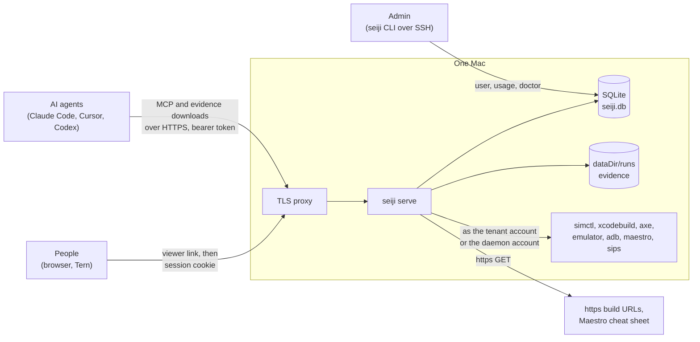
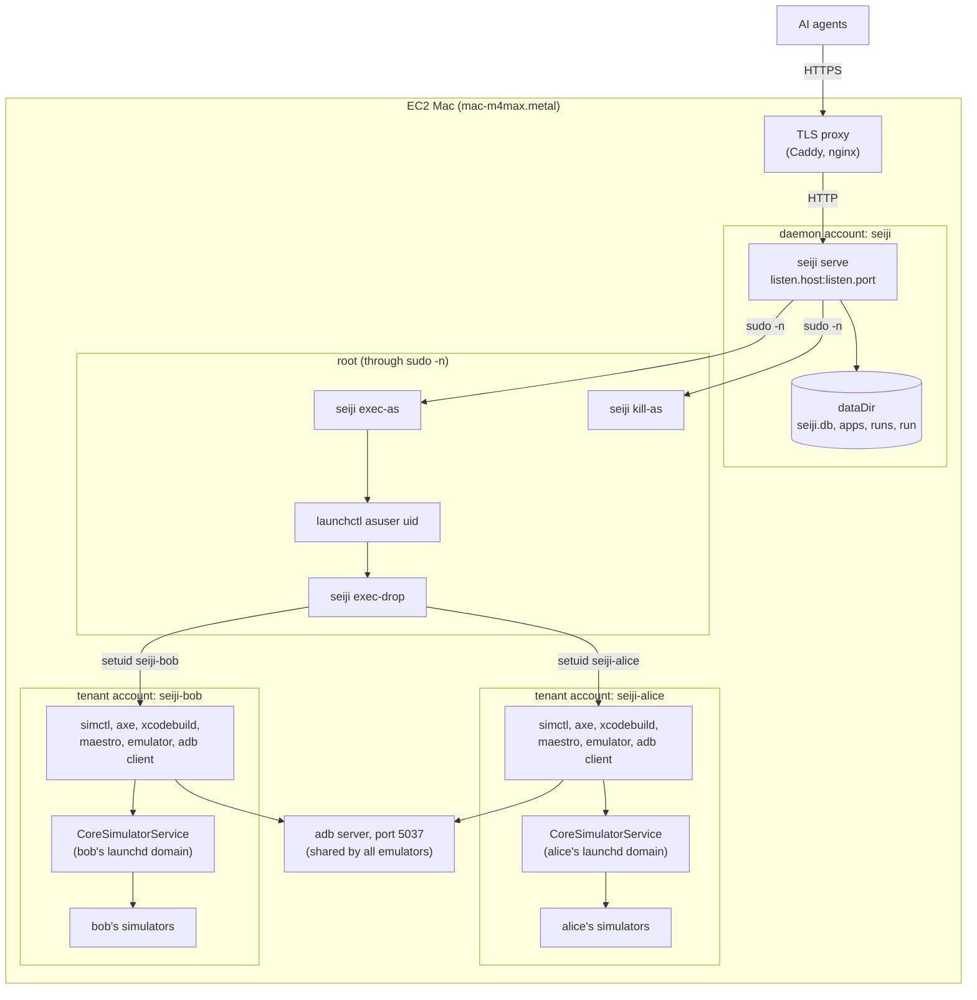
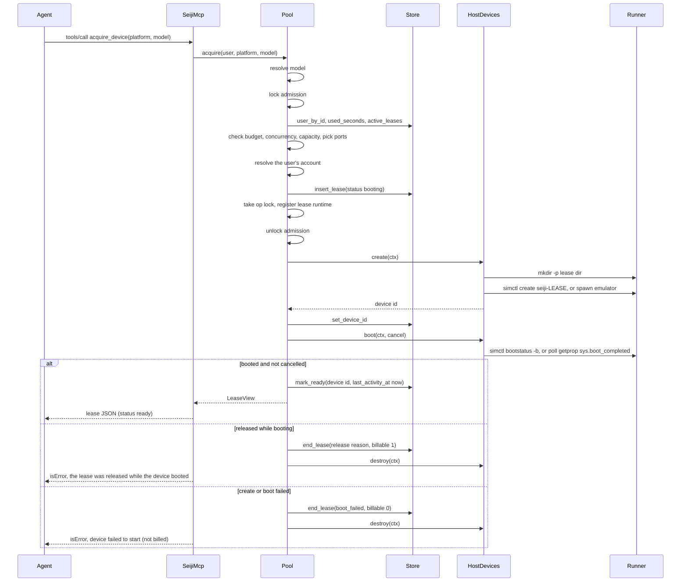
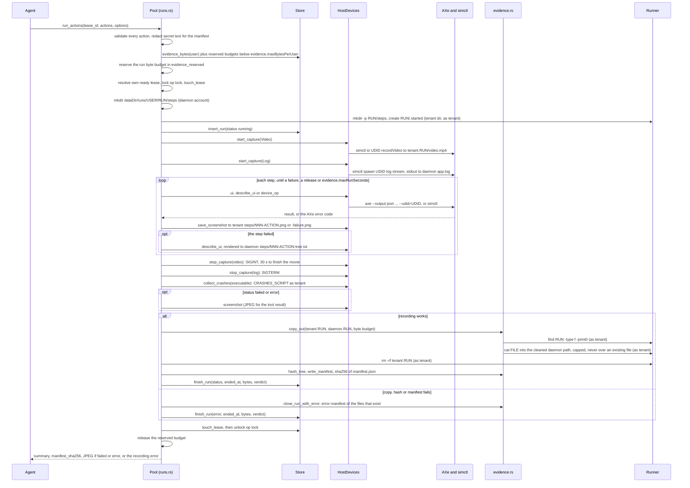
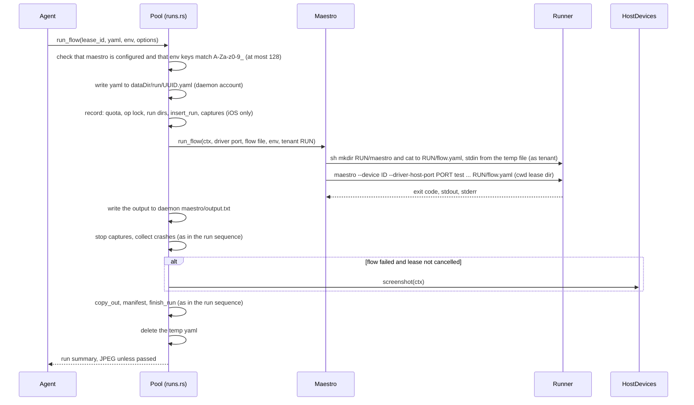
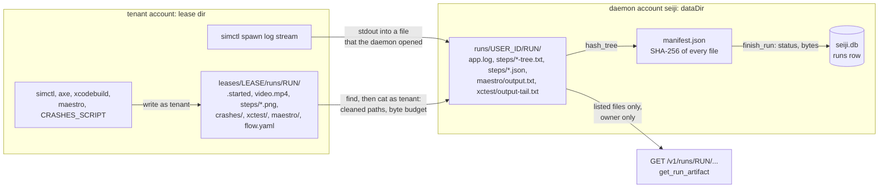

# Architecture

This document describes the components of Seiji, how a request flows through them, how a run records its evidence, how the viewer streams a screen, how the daemon runs commands as a tenant account, where Seiji stores state, and what happens at start and stop. [concepts.md](concepts.md) explains the behavior. [security.md](security.md) explains the trust boundaries.

## Contents

- [System context](#system-context)
- [Components](#components)
- [Deployment on one EC2 Mac](#deployment-on-one-ec2-mac)
- [Request path](#request-path)
- [Acquire sequence](#acquire-sequence)
- [Run sequence](#run-sequence)
- [Flow sequence](#flow-sequence)
- [Viewer sequence](#viewer-sequence)
- [Evidence data flow](#evidence-data-flow)
- [Privilege chain](#privilege-chain)
- [Process groups and killing](#process-groups-and-killing)
- [Data model](#data-model)
- [Startup recovery](#startup-recovery)
- [Graceful shutdown](#graceful-shutdown)
- [Design decisions](#design-decisions)

## System context

AI agents call Seiji as a remote MCP server over HTTPS. Seiji runs on one Mac. It creates simulators and emulators there. It drives iOS simulators with AXe and the native Xcode tools (`simctl`, `xcodebuild`, `xcresulttool`), and runs Maestro flows when Maestro is configured. People can watch and drive a lease's iOS simulator in the viewer, in a browser or in Tern. An admin manages users with the `seiji` CLI on the same host.



## Components

| Component | Job | Code |
|---|---|---|
| HTTP server | An axum router. `GET /healthz` is open. `/mcp`, `POST /v1/apps`, the evidence downloads (`GET /v1/runs/{run_id}/files/{*path}`, `/evidence.zip`, `/report.md`), `GET /v1/me`, the admin endpoints (`GET /v1/admin/users`, `PUT /v1/admin/users/{id}/limits`, `GET /v1/admin/leases`, `POST /v1/admin/leases/{lease_id}/viewer`, `GET` and `PUT /v1/admin/viewer`), `POST /v1/leases/{lease_id}/viewer`, `GET /v1/leases/{lease_id}/screenshot.jpg` and the WebSocket `GET /v1/leases/{lease_id}/forward` sit behind the auth middleware. The admin endpoints also check `adminUsers` and return `403` for non-admin callers. The viewer routes (`/view/…`) check a session cookie instead. | `src/http.rs` |
| Auth middleware | Reads `Authorization: Bearer <token>`, looks up the SHA-256 of the token, refuses a missing, unknown or disabled token with `401`, and puts the user into the request as `AuthedUser`. | `src/http.rs` |
| MCP service | rmcp `StreamableHttpService` with `NeverSessionManager`, legacy session mode off and SSE responses with 15 s keepalive comments: every POST is handled on its own, the response starts as `text/event-stream` immediately and sends keepalive comments while the tool runs, so a TLS proxy never times out on idle reads. It checks the `Host` header against `listen.allowedHosts`. A factory builds one `SeijiMcp` for each request. | `src/http.rs`, `src/mcp.rs` |
| `SeijiMcp` | The 23 tools and the server instructions. Reads the caller from `AuthedUser` and turns each `Pool` result into a tool result. Caches the Maestro cheat sheet for the process. | `src/mcp.rs` |
| Viewer | Viewer links, tickets and viewer sessions (in memory), the `/view/…` routes and the page's WebSocket, one shared `seiji-sim` helper per watched lease whose H.264 frames fan out to every viewer through a broadcast channel with per-viewer flow control, and input: touches, keys and buttons to the helper's persistent HID connection, text through AXe, under the lease's op lock. With `viewer.webrtc`, a page can also take the stream over SRTP and send input on a data channel (`str0m`, one UDP port per session, ICE-lite). The page (`index.html`, `viewer.js`, `viewer.css`) is embedded in the binary. | `src/viewer.rs`, `src/viewer/` |
| Screen helper | `seiji-sim`, a Swift tool built on the host: reads the simulator's framebuffer IOSurface, encodes H.264 with VideoToolbox, and sends touches, keys and buttons through one `SimDeviceLegacyHIDClient`. It speaks framed messages on stdout and JSON lines on stdin, and runs as the user's account through `Runner`. | `sim/` |
| Tunnel | `seiji forward`: admits a tunnel for the caller's `ready` lease (`forward.enabled`, `forward.maxPerLease`), listens on a new port on `127.0.0.1`, and carries each connection to it over the WebSocket in OPEN, DATA and CLOSE frames. Touches the lease every 60 s and closes with it. The client end dials only its one local port. | `src/forward.rs` |
| `Pool` | Admission, acquire and release, lease operations under the op lock, budget and models views, downloads, the reaper, recovery and shutdown. Holds the admission lock and the in-memory runtime of each lease (op lock, cancellation token, installed app). | `src/pool.rs` |
| Runs | The `Pool` methods for runs: `record` and `record_locked` (quota, run dirs, captures, engine, crash collection, failure screenshot, copy, manifest), the engines `actions`, `flow` and `xctest`, the device tools (`device_op`, `logs`), and `list_runs`, `run_manifest`, `run_file`, `run_url`. | `src/runs.rs` |
| Actions | The `run_actions` step model: the `Action` enum and its arguments, `Selector`, validation limits, `execute` (the step loop), `render_tree` (the one-line-per-node tree of `inspect_screen` and failure trees) and `redacted`. | `src/actions.rs` |
| iOS commands | Pure builders of `simctl` and AXe command lines, `parse_axe` (the AXe JSON envelope), and the shell scripts `INSTALL_SCRIPT`, `XCTEST_SCRIPT` and `CRASHES_SCRIPT`. `valid_test_id` checks XCTest filters. | `src/ios.rs` |
| Evidence | The run dir layout, `copy_out` (tenant files into the daemon dir), the `Manifest` (schema `seiji.run.v1`), SHA-256s, `markdown`, the `maestro_steps` and `xctest_steps` parsers, `preview_jpeg` and `zip`. | `src/evidence.rs` |
| `Store` | SQLite in WAL mode: users, leases (the usage ledger), builds and runs. One connection behind a mutex. A 5 s busy timeout lets the CLI write while `seiji serve` runs. | `src/store.rs` |
| `Runner` | Runs every host command as the right account: directly (`shared`) or through `sudo -n seiji exec-as` (`os_user`). Each command leads its own process group. Enforces timeouts and cancellation, and caps captured output at 32 MiB for each stream. `run_to_file` streams a command's stdout into a daemon file up to a byte cap. `interrupt` stops a group with SIGINT (for `recordVideo`). | `src/exec.rs` |
| `HostDevices` | The `Devices` trait on the host: `simctl` for iOS, `emulator` and `adb` for Android, `sips` for screenshots, app install (returns `InstalledApp`), orphan cleanup. For iOS also `ui` and `describe_ui` (AXe), `save_screenshot`, `start_capture` and `stop_capture` (video and log), `device_op`, `run_xctest` and `collect_crashes`; on Android these fail with "... supports iOS simulators only for now". Keeps the emulator and capture processes. | `src/devices.rs` |
| `Maestro` | Builds `maestro --device <id> --driver-host-port <port> test` and `hierarchy` calls. Optional: only with `maestro` in the config. | `src/maestro.rs` |
| Root helpers | `seiji exec-as`, `seiji exec-drop`, `seiji kill-as`: hidden subcommands that run as root through sudo and never read the config. `seiji tenant provision` creates tenant accounts; an admin runs it with sudo. | `src/tenant.rs`, `src/main.rs` |
| CLI | `serve`, `user`, `usage`, `tenant provision`, `doctor`, and the client commands `login`, `logout`, `token print` and `forward`. See [cli.md](cli.md). | `src/main.rs` |
| Client | `seiji login`, `seiji logout`, `seiji token print` and `seiji forward` on a developer's Mac: checks a token with `GET /v1/me`, keeps it in the macOS login keychain, and hands it to the Tern plugin. `seiji forward` picks the lease with `budget_status`, opens the tunnel, and points the app at it with `open_url`, or `configure_device` and `launch_app`. | `src/client.rs` |
| Tern plugin | A Tern panel with your budget, devices and runs. It opens a device's viewer in Tern's browser beside the panel, boots and releases devices, and reads the credential with `seiji token print --json`. See [tern.md](tern.md). | `tern-plugin/` |

## Deployment on one EC2 Mac

The target host is an AWS EC2 `mac-m4max.metal` dedicated host. A TLS proxy terminates HTTPS. launchd runs `seiji serve` as the daemon account `seiji` (`deploy/dev.seiji.daemon.plist`). sudoers lets `seiji` run only `exec-as` and `kill-as` as root (`deploy/sudoers.seiji`).



- Each tenant account has its own CoreSimulatorService in its own launchd domain, so each tenant account has its own simulator device set.
- All Android emulators share one adb server on port 5037, because Maestro hardcodes that port. See [security.md](security.md#android-and-the-shared-adb-server).
- With `isolation.mode: "shared"`, the root zone and the tenant accounts are absent. Every command runs as `seiji` in one device set.

> **Warning:** The `os_user` path (simctl for a tenant account through `launchctl asuser`, never logged in to the GUI) has not been tested on a real host. `seiji doctor <user>` is the check, and `isolation.mode: "shared"` is the fallback. Android on EC2 Mac (Hypervisor.framework on bare metal) is not verified either.

## Request path

1. The agent sends `POST /mcp` with a JSON-RPC body and `Authorization: Bearer sj_...`.
2. The auth middleware hashes the token, finds the user, and refuses a disabled user. A refusal is HTTP `401` with "missing, invalid or disabled bearer token". The MCP layer never sees it.
3. The MCP service checks the `Host` header against `listen.allowedHosts`.
4. The factory builds a `SeijiMcp` for this request. The tool reads the user from the request extensions.
5. The tool calls `Pool`. A `Pool` error becomes a tool result with `isError: true` and the error chain as text.
6. The response is an SSE stream (`Content-Type: text/event-stream`). The server sends the HTTP headers at once and sends keepalive comments every 15 s while the tool runs, so a TLS proxy whose idle read timeout is above 15 s never cuts the connection. The tool result arrives as a `data:` event with the JSON-RPC message. A tool call keeps the HTTP request open until it ends: up to `evidence.maxRunSeconds` (default 1800) plus the evidence collection for `run_actions`, `xctest.timeoutSeconds` (default 3600) for `run_xctest`, `maestro.flowTimeoutSeconds` (default 600) for `run_flow`, and up to the boot timeout for `acquire_device`. The proxy needs only an idle timeout above 15 s; the absolute operation timeout does not matter.

`POST /v1/apps` and the `GET /v1/runs/{run_id}/...` downloads take steps 1 and 2, then stream the body. [mcp.md](mcp.md) gives the interface.

`GET /v1/leases/{lease_id}/forward` takes steps 1 and 2, then upgrades to a WebSocket that stays open as a tunnel for `seiji forward`. It takes no op lock. [apps.md](apps.md#how-the-tunnel-works) shows how the tunnel carries a connection, and [security.md](security.md#tunnels-seiji-forward) what it can reach.

The admin endpoints (`GET /v1/admin/users`, `PUT /v1/admin/users/{id}/limits`, `GET /v1/admin/leases`, `POST /v1/admin/leases/{lease_id}/viewer`, `GET` and `PUT /v1/admin/viewer`) take steps 1 and 2, then check that the caller's name is in `adminUsers` (from the config, not the database). A non-admin caller gets `403`. The limits PUT also holds the admission lock so a concurrent `acquire_device` sees the new limits. The admin viewer link is the one lease lookup that skips the owner check (`Pool::admin_lease`). The viewer settings live in memory (`Viewers::settings`), start from `seiji.json` and go back to it at a restart. [mcp.md](mcp.md#get-v1adminusers) gives the interface.

## Acquire sequence



- Admission holds the admission lock for the checks, the account lookup and the insert. Create and boot run under the lease's op lock, so a slow boot blocks no other user.
- The op lock is taken before the lease is visible to `release`. A release during the boot records its reason in the lease runtime, cancels the boot, and waits for the op lock. `acquire` then ends the lease with that reason and deletes the device.
- `set_device_id` runs before the boot, so a crash during the boot still leaves the device id for [recovery](#startup-recovery).
- `mark_ready` changes only a `booting` lease. It sets `last_activity_at`, so the idle clock starts at ready.

## Run sequence

All three run tools go through `Pool::record`. This is `run_actions`; the [flow sequence](#flow-sequence) shows what differs for `run_flow`.



- The validation and the quota check run before the op lock. A refused call creates no run. The check counts the bytes of the user's finished runs plus the budgets that the user's running runs reserved (`Pool.evidence_reserved`), so parallel runs cannot overshoot the quota together. The reservation is returned when the run ends, however it ends.
- A failure while recording the evidence closes the run with `close_run_with_error`: an `error` manifest with the warning "recording the run failed" and `finish_run`. The tool fails with `run <run id> failed while recording its evidence: ...`. No run stays `running`.
- Every step of the run, from the tenant dir to `finish_run`, happens under the op lock. No other operation reaches the device in between.
- Each AXe command has the timeout `axe.stepTimeoutSeconds`. A `type` step writes its text to a daemon-owned file in `<dataDir>/run/` and passes it as stdin to `axe type --stdin`. The file is deleted after the step.
- A release cancels the step loop, but not the evidence collection. Stopping the captures, crash collection, `copy_out` and the manifest use their own timeouts (each copy at most 900 s), so a cancelled run still ends with a manifest.
- `run_xctest` replaces the step loop with `XCTEST_SCRIPT` as the tenant: copy the build in, unpack it, find the `.xctestrun`, run `xcodebuild test-without-building -xctestrun <file> -destination "platform=iOS Simulator,id=<udid>" -resultBundlePath <out>/result.xcresult`, then `xcresulttool get test-results summary` and `tests`, `xcresulttool export attachments`, and zip the result bundle with `ditto`. Its timeout is `xctest.timeoutSeconds`.
- After the copy, `maestro_steps` and `xctest_steps` read the step records from the daemon's copy, never from the tenant's files in place.

## Flow sequence



The Maestro command is:

```sh
maestro --device <device id> --driver-host-port <driver port> test --no-ansi \
  --format junit --output <run dir>/maestro/report.xml \
  --debug-output <run dir>/maestro/debug --flatten-debug-output \
  --test-output-dir <run dir>/maestro/output \
  -e KEY=VALUE ... <run dir>/flow.yaml
```

- The tenant's run dir is `<lease dir>/runs/<run id>`. `copy_out` copies it into the evidence and then deletes it.
- The environment adds `MAESTRO_CLI_NO_ANALYTICS=1`, `MAESTRO_CLI_ANALYSIS_NOTIFICATION_DISABLED=true`, `MAESTRO_DISABLE_UPDATE_CHECK=true`, and `JAVA_HOME` (from `maestro.javaHome`) and `ANDROID_HOME` (from `android.sdkRoot`) when they are set.
- The timeout is `maestro.flowTimeoutSeconds`. On a timeout, the Runner kills the process group and the verdict is "the flow timed out (maestro.flowTimeoutSeconds)".
- `inspect_screen` on Android runs `maestro --device <id> --driver-host-port <port> hierarchy --no-ansi --compact` with a 120 s timeout. On iOS it runs `axe --output json describe-ui --udid=<udid>` and renders the tree with `render_tree`.
- Screenshots for the agent: `simctl io <udid> screenshot --type=png` or `adb -s <serial> exec-out screencap -p` into the lease dir, then `sips -Z 2000 -s format jpeg -s formatOptions 85`. The JPEG has its longest side at 2000 px or less. Screenshots in a run stay full-resolution PNGs.

## Viewer sequence

The viewer works on iOS leases only. Every viewer request resolves its session first (see [security.md](security.md#the-viewer)).

```mermaid
sequenceDiagram
  participant U as Person (browser or Tern)
  participant A as Agent or Tern plugin
  participant H as http.rs
  participant V as viewer.rs (Pool)
  participant R as Runner
  participant X as seiji-sim

  A->>H: share_screen, or POST /v1/leases/LEASE/viewer (bearer)
  H->>V: create_viewer(user, lease, control)
  V-->>A: url /view/open/TICKET, expires_in 60
  A-->>U: the viewer link
  U->>V: GET /view/open/TICKET
  V->>V: remove the ticket, make a session, keep SHA-256 of its secret
  V-->>U: 303 to /view/s/SID/, Set-Cookie seiji_view (Path=/view/s/SID)
  U->>V: GET /view/s/SID/ and /info (cookie)
  U->>V: GET /view/s/SID/ws (cookie, Origin of this host)
  alt first viewer of the lease
    V->>R: seiji-sim session --udid UDID --fps --scale --bitrate (as the user's account)
    R->>X: start, stdin and stdout piped
  end
  X-->>V: format (codec, size, avcC)
  V-->>U: format, to every viewer of the lease
  loop each frame
    X-->>V: H.264 sample (AVCC), keyframe flag, capture time
    V-->>U: binary frame, unless this viewer is congested
    U-->>V: ack seq
  end
  U->>V: touch down (x, y)
  V->>V: wait up to 1 s for the op lock, else busy; hold it until touch up
  V->>X: one JSON line on stdin per touch, key or button
  U->>V: touch move, touch up
  V->>X: move, up; release the op lock
```

- One helper process serves every viewer of a lease. A tokio broadcast channel carries each format and frame, built once, to every viewer. A viewer that falls behind the channel, or whose oldest unacknowledged frame is older than its base round trip plus 200 ms, skips frames until it catches up and resumes at a keyframe. Congestion also cuts the shared bitrate (see [mcp.md](mcp.md#the-stream)).
- The helper's output is untrusted (it runs as the tenant): Seiji checks the framing, a message is at most 4 MiB, and a `format` must have an `avc1.` codec, sizes of 2–8192 and a base64 record. The shared buffer keeps at most 32 messages, so one watched lease holds at most 128 MiB of video.
- The stream starts with the first viewer and stops when the last one leaves or the lease ends: its cancellation token is a child of the lease's. If the helper exits while someone watches, Seiji starts it again after 1 s.
- While someone watches, Seiji touches the lease every 60 s, so a watched device is not released as idle. Every 30 s, Seiji logs a structured line with the stream's fps, kbit/s, bitrate and viewer count, and for each viewer a `viewer pipeline` line that splits its frames' age and its input into stages: encode, helper → server, in server, network, decode, input in server (`src/viewer/pipeline.rs`, [mcp.md](mcp.md#where-the-time-goes)). Each frame carries its capture, encode and receipt times for that.
- Input takes the lease's op lock like a tool call, so it never interleaves with a run; a gesture holds it from touch down to touch up. Each viewer's input runs in order in its own task, apart from the video, so a slow input never stalls the picture. A reader task takes the page's messages apart from the writes, so input reaches the device while a frame still waits on a slow link. Moves and lifts with the page's `ts` keep the gesture's own spacing, up to `viewer.paceMaxMs` (80 ms; an admin can change it while Seiji runs) ([mcp.md](mcp.md#gesture-timing)). Touches, keys and buttons go to the helper's persistent HID connection; text goes through AXe (`type`, and `paste`: `axe clipboard copy` and then Cmd+V through the helper). Before AXe types, Seiji waits until the helper has the inputs sent before.
- With `viewer.webrtc.enabled`, the page sends a WebRTC offer on its WebSocket. The reader answers it from `src/viewer/rtc.rs`: one `str0m` instance and one UDP port per session, driven by a tokio task that subscribes to the same broadcast channel. It turns each AVCC frame into Annex B (with the SPS and PPS before keyframes), sends it with the capture time as RTP time and a playout delay of 0, and holds the shared bitrate under 85 % of the bandwidth estimate (`Hub::cap`; the lowest estimate wins). Input on the `input` data channel joins the WebSocket's input queue. Once the page plays the WebRTC video it sends `video_via rtc`, and its WebSocket stops carrying frames; `video_via ws` brings them back at a keyframe.
- A controller can pick a quality preset (`smooth`, `balanced`, `sharp`) that changes the helper's fps, scale and bitrate without a restart. The preset applies to the shared stream for all viewers. `GET /view/s/{sid}/stats` and a toggleable overlay in the page show stream stats (fps, bitrate, resolution, codec, transport, round trip, jitter, frame age).
- Tickets and sessions live in memory. The reaper prunes expired ones every 15 s.

## Evidence data flow

A run has two directories with the same relative layout. The device tools write as the tenant account into the **tenant run dir** in the lease dir. Seiji writes its own files into the **daemon run dir** and, at the end, copies the tenant's files over.



| Step | Detail |
|---|---|
| List | `/usr/bin/find <tenant run dir> -type f -print0`, as the tenant account, 60 s. Symlinks are not regular files, so `find` does not list them. A failed listing is a warning, not an error. |
| Clean | Each relative path is cleaned component by component: every character outside `[A-Za-z0-9._-]` becomes `_`, a component keeps at most 128 characters, and leading dots are removed. A path with an empty, `.` or `..` component, a component that is empty after cleaning, or more than 8 components is skipped with a warning ("skipped a file with an unusable name: ..."). A name that is not UTF-8 is skipped. `.started` is skipped. |
| Keep | A cleaned path that already exists in the daemon run dir is not copied: Seiji's own files (`app.log`, failure trees, outputs) and an earlier tenant name that cleans to the same path keep their place. The warning is `skipped "<rel>": <clean> already exists in the evidence`. |
| Budget | Each file may use the rest of the run byte budget. A file that does not fit is removed and listed in `dropped`. |
| Copy | `Runner::run_to_file` runs `/bin/cat <file>` as the tenant account and streams its stdout into the daemon path, up to the rest of the budget, with a 900 s timeout. A tenant path is only ever opened with the tenant account's rights. |
| Clean up | `/bin/rm -rf <tenant run dir>` as the tenant account. |
| Hash | `hash_tree` lists every regular file of the daemon run dir except `manifest.json`, with its size and SHA-256, sorted by path. `write_manifest` writes a temporary file and renames it to `manifest.json`. |

Under `shared`, the tenant run dir is in `<dataDir>/tenants/<user>/leases/<lease id>/runs/<run id>` and every step runs as the daemon account.

## Privilege chain

With `isolation.mode: "os_user"`, the daemon account never runs a device command itself. Each command goes through this chain:

1. The Runner starts `/usr/bin/sudo -n <isolation.helper> exec-as <tenant account> [--pidfile <file>] [--cwd <dir>] --env PATH=<path> [--env KEY=VALUE ...] -- <program> <args...>`. `-n` makes sudo fail instead of asking for a password. The sudo process leads a new process group. Its stdin is nothing, a file that the daemon opened (this is how builds, flows, typed text and push payloads reach the tenant account), or a pipe that the daemon writes JSON lines to (the viewer's screen helper). Its stdout is a pipe, or a file that the daemon opened (the log stream of a run).
2. sudo allows only `/usr/local/bin/seiji exec-as *` and `/usr/local/bin/seiji kill-as *` for `seiji`, with `env_reset`.
3. `exec-as` runs as root. It refuses to run unless the effective uid is 0 ("must run as root (through sudo)"). It validates the tenant account (see [security.md](security.md#root-helper-invariants)): it exists, its uid is 501 or higher, it is in `seiji-tenants`, and it is not in the admin group (gid 80).
4. `exec-as` replaces itself with `/bin/launchctl asuser <uid> <own binary> exec-drop <tenant account> ...` and the same arguments. The command now runs in the tenant account's per-user launchd domain, where that account's CoreSimulatorService lives.
5. `exec-drop` runs as root inside that domain. It requires root and validates the tenant account again.
6. It clears the environment and sets only `HOME` (the account's home), `USER`, `LOGNAME`, `SHELL=/bin/zsh`, `PATH`, and then each `--env KEY=VALUE`.
7. In the child, before the program starts:
   1. `setsid()`: a new session and process group, with the child as leader.
   2. `initgroups`, `setgid`, `setuid` to the tenant account.
   3. `setuid(0)` must fail, and the effective uid and gid must be the tenant's. Otherwise the child stops with "privilege drop did not stick".
   4. `chdir` to `--cwd`, or to the home. This runs as the tenant account, so the kernel checks the path against the tenant's rights.
   5. If `--pidfile` is set, it writes its pid (the process group id) to that file as the tenant account, with mode `0644` so the daemon can read it.
   6. It sets the umask to `077`, so the files that the program creates are private to the tenant account.
8. It replaces itself with the program.

`kill-as <tenant account> <pgid> <signal>` requires root, refuses a pgid of 1 or less, validates the tenant account, drops to it with the same steps and checks as 7.2 and 7.3, and calls `killpg`. As the tenant account, the kernel lets it signal only that account's processes. A group that no longer exists is not an error. The Runner logs a warning when `kill-as` fails ("kill-as refused: ...") or cannot start ("kill-as did not start: ...").

With `isolation.mode: "shared"`, the Runner runs the program directly as `seiji`, with the daemon's environment plus `PATH` and the command's variables, in a new process group.

The `PATH` is `/opt/homebrew/bin:/usr/local/bin:/usr/bin:/bin:/usr/sbin:/sbin` in both modes.

## Process groups and killing

Every command leads its own process group, so Seiji can stop the command and everything that it started. The Runner kills a group on a timeout, on cancellation (a release) and when an emulator does not stop.

| Mode | Process group id | Signal path |
|---|---|---|
| `shared` | the pid of the direct child (`Direct`) | `killpg` from the daemon |
| `os_user` | the pid in `<dataDir>/run/pids/<uuid>.pid`, written by `exec-drop` after `setsid` (`PidFile`) | `sudo -n seiji kill-as <tenant account> <pgid> <signal>` |

The kill sequence:

1. Resolve the group. For a pidfile, wait up to 5 s for `exec-drop` to write it. If the command exits first, or the file never appears, kill only the direct child.
2. Send SIGTERM to the group.
3. Wait up to 5 s for the command to exit.
4. Send SIGKILL to the group and kill the direct child.

`stop_capture` of a screen recording uses `Runner::interrupt` instead: SIGINT to the group, up to 30 s for `simctl io recordVideo` to write the movie's index, then SIGKILL. A SIGTERM would leave a file that does not play. A log stream stops with the normal SIGTERM sequence.

The sudo process cannot be the handle in `os_user` mode: `exec-drop` calls `setsid`, so the tenant processes are in a group that the daemon did not create. The pidfile carries that group id back. The Runner deletes the pidfile when the command's `Job` is dropped. `run/pids` has mode `1733`: a tenant account can create a file there, but cannot list the directory or remove another account's file.

## Data model

`Store` keeps one SQLite file, `<dataDir>/seiji.db`, in WAL mode with foreign keys on. All times are Unix seconds.

### `users`

| Column | Type | Meaning |
|---|---|---|
| `id` | INTEGER PRIMARY KEY | User id. Also the directory name under `<dataDir>/apps/` and `<dataDir>/runs/`. |
| `name` | TEXT NOT NULL UNIQUE | User name. |
| `token_hash` | TEXT NOT NULL UNIQUE | SHA-256 (hex) of the token. |
| `os_user` | TEXT | Tenant account name. NULL when the user was added under `shared`. |
| `monthly_minutes` | INTEGER NOT NULL | Quota `monthlyMinutes`. |
| `max_concurrent` | INTEGER NOT NULL | Quota `maxConcurrent`. |
| `max_lease_minutes` | INTEGER NOT NULL | Quota `maxLeaseMinutes`. |
| `idle_minutes` | INTEGER NOT NULL | Quota `idleMinutes`. |
| `disabled` | INTEGER NOT NULL DEFAULT 0 | 1 when the user is disabled. |
| `created_at` | INTEGER NOT NULL | Creation time. |

### `leases`

| Column | Type | Meaning |
|---|---|---|
| `id` | TEXT PRIMARY KEY | Lease id, `l_<12 hex>`. |
| `user_id` | INTEGER NOT NULL | Owner (`users.id`). |
| `platform` | TEXT NOT NULL | `ios` or `android`. |
| `model` | TEXT NOT NULL | Model name from the config. |
| `device_id` | TEXT | Simulator UDID or `emulator-<console port>`. NULL before create. |
| `driver_port` | INTEGER NOT NULL | Maestro `--driver-host-port`. |
| `console_port` | INTEGER | Android console port. NULL for iOS. |
| `status` | TEXT NOT NULL | `booting`, `ready` or `ended`. |
| `started_at` | INTEGER NOT NULL | Admission time. Billing starts here. |
| `last_activity_at` | INTEGER NOT NULL | The time the device became ready, or the start or end of the last lease operation. |
| `ended_at` | INTEGER | End time. NULL while active. |
| `end_reason` | TEXT | One of the end reasons in [concepts.md](concepts.md#leases). |
| `billable` | INTEGER NOT NULL DEFAULT 1 | 0 for `boot_failed`. |

Indexes: `leases_user (user_id, started_at)` and the partial index `leases_active (status) WHERE status != 'ended'`.

### `apps`

| Column | Type | Meaning |
|---|---|---|
| `id` | TEXT PRIMARY KEY | Build id, `a_<12 hex>`. |
| `user_id` | INTEGER NOT NULL | Owner (`users.id`). |
| `filename` | TEXT NOT NULL | Sanitized file name. |
| `path` | TEXT NOT NULL | `<dataDir>/apps/<user id>/<app_id>/<filename>`. |
| `size` | INTEGER NOT NULL | Bytes. |
| `created_at` | INTEGER NOT NULL | Arrival time. Retention counts from here. |

A user keeps at most `maxBuildsPerUser` rows in `apps` at a time.

The `leases` table is the only source of usage. `seiji usage`, `budget_status`, admission and the reaper all compute usage with the same query ([concepts.md](concepts.md#the-month-window)).

### `runs`

| Column | Type | Meaning |
|---|---|---|
| `id` | TEXT PRIMARY KEY | Run id, `r_<12 hex>`. |
| `user_id` | INTEGER NOT NULL REFERENCES users(id) | Owner. |
| `lease_id` | TEXT NOT NULL | The lease the run used. |
| `kind` | TEXT NOT NULL | `actions`, `flow` or `xctest`. |
| `name` | TEXT | The run's `name` option. |
| `tags` | TEXT NOT NULL DEFAULT '[]' | The tags as a JSON array. `list_runs` filters on one element with `json_each`. |
| `status` | TEXT NOT NULL | `running`, `passed`, `failed`, `error` or `cancelled`. |
| `started_at` | INTEGER NOT NULL | Start time. |
| `ended_at` | INTEGER | End time. NULL while `running`. Retention counts from here. |
| `bytes` | INTEGER NOT NULL DEFAULT 0 | Size of the daemon run dir at the end, also for runs closed with `error`. The sum over a user's rows, plus the budgets reserved by the user's running runs, is the evidence that counts against `evidence.maxBytesPerUser`. |
| `summary` | TEXT | The verdict. |

Index: `runs_user (user_id, started_at)`. The files of a run are in `<dataDir>/runs/<user id>/<run id>/`. The row is the index of the files: `get_run` and the downloads find a run by id and owner together, and the reaper deletes the row (`take_runs_before`) and then the directory. `seiji user remove` deletes the user's rows and both `<dataDir>/apps/<user id>` and `<dataDir>/runs/<user id>`.

### Files

Every `seiji` command except the root helpers sets the umask to `077`, so the files that the daemon account creates are private to it. `Runner::new` then sets the modes that tenant accounts need.

| Path | Content | Mode |
|---|---|---|
| `<dataDir>` | The data directory. | `0711`, set at every start |
| `<dataDir>/seiji.db` | The database (plus `-wal` and `-shm`). | private (umask `077`) |
| `<dataDir>/apps/<user id>/<app_id>/` | Builds. | private (umask `077`) |
| `<dataDir>/run/` | Daemon-owned files in transit: flow YAML (`<uuid>.yaml`), typed text (`<uuid>.txt`), push payloads (`<uuid>.apns`), `evidence.zip` builds (`<uuid>.zip`), JPEG previews (`<uuid>.jpg`), `recordVideo` output (`cap-<uuid>.log`) and emulator logs (`emulator-<lease id>.log`). | `0711`, set at every start |
| `<dataDir>/run/pids/` | Pidfiles of tenant process groups. | `1733`, set at every start |
| `<dataDir>/runs/<user id>/<run id>/` | The evidence of a run: `manifest.json` and the run's files. | private (umask `077`) |
| `<dataDir>/tenants/<user>/` | Workspace of a user under `shared`. | private (umask `077`) |
| `~<tenant account>/seiji/` | Workspace of a user under `os_user`. | private (umask `077` of `exec-drop`), in a home with mode `700` |
| `<workspace>/leases/<lease id>/` | Lease dir: `app/`, `runs/<run id>/` (the tenant run dir while a run executes), screenshots in progress. | as the workspace |

## Startup recovery

The in-memory state (op locks, cancellation tokens, installed apps, emulator and capture processes, viewer tickets, viewer sessions and streams) does not survive a restart. So `seiji serve` ends every lease and every run that was active before it starts to listen. `Pool::recover`:

1. `fail_running_runs`: every run that is still `running` becomes `error`, with `ended_at` now. `close_run_with_error` then writes its manifest: the verdict "server restarted during the run", the warning "the server restarted during the run; only files written before that are kept", the files that exist in the daemon run dir, and their bytes, which count against the quota. The tenant run dir was never copied; it goes with the lease dir in step 2. `get_run` and the downloads work as for any finished run, and the reaper deletes the run at retention.
2. For each lease that is not `ended`: end it with `server_restart`, billed up to its last recorded activity (`ended_at` = the later of `last_activity_at` and `started_at`), then destroy its device when the owner and the owner's account still resolve. The destroy deletes the lease dir, with the tenant run dirs in it. The time while `seiji serve` was down is not billed.
3. For each distinct account (each tenant account, or the one daemon account under `shared`): list the simulators and delete every one whose name starts with `seiji-`. This removes devices that a crash left behind, including those of `seiji doctor`.

Then `seiji serve` starts the reaper, builds the router and binds `listen.host:listen.port`.

The orphan scan covers iOS only. An Android emulator of a recovered lease stops through `adb -s emulator-<port> emu kill` in step 2.

Finished runs survive a restart: their rows and files stay, and the reaper deletes them at retention as usual.

## Graceful shutdown

On SIGTERM or Ctrl-C, the graceful-shutdown future of axum runs these steps:

1. `seiji serve` cancels its shutdown token. The reaper stops, and the MCP service gets the cancellation.
2. `Pool::release_all("server_shutdown")` releases every active lease at the same time and deletes its device. A release cancels the running operation, so open flows and `xcodebuild` runs end at once. A run still stops its captures and copies its evidence before the release deletes the device; it ends `cancelled`. A lease that is still booting ends with `server_shutdown` too.
3. axum stops accepting connections and drains the open requests. They end quickly, because their leases are gone.

The launchd plist sets `ExitTimeOut` to 120 s. If the releases take longer (a run with a large video can take longer to copy), launchd kills the process. The next start then ends the remaining leases with `server_restart` and the remaining runs with `error`.

## Design decisions

### Maestro CLI instead of `maestro mcp`

`maestro mcp` hardcodes the iOS XCTest driver port 22087 (`McpMaestroSessionManager.DEFAULT_XCTEST_PORT`). Two iOS simulators on one host would both use it, so only one lease could run at a time. Seiji runs `maestro --device <id> --driver-host-port <port> test|hierarchy` for each operation, with one driver port for each lease. The cost is a JVM start for each call. The gain is any number of parallel leases, and a plain process that the Runner can time out and kill.

### AXe and native Xcode tools for iOS, not Maestro

On iOS, Seiji drives the screen with [AXe](https://github.com/cameroncooke/AXe) (MIT, `brew install cameroncooke/axe/axe`, default path `/opt/homebrew/bin/axe`). Everything else is native: `xcrun simctl` for screenshots, `io recordVideo`, `spawn log stream` and `log show`, `status_bar`, `ui appearance`, `location`, `privacy`, `push`, `launch`, `terminate`, `uninstall` and `openurl`, and `xcodebuild test-without-building` with `xcrun xcresulttool` for XCTest. Maestro is optional and serves only `run_flow`, and `inspect_screen` on Android.

- AXe is one short-lived native process for each command: a tap, a text, a gesture or a tree read. The Runner times it out (`axe.stepTimeoutSeconds`) and kills it like any other command. There is no JVM start and no driver port.
- AXe answers in JSON with typed error codes (for example `elementNotFound`), so a failed step has a precise error, and `describe-ui` gives the accessibility tree that selectors and failure trees use.
- AXe arguments use the `--key=value` form, so a label that starts with `-` never becomes a flag. Typed text never reaches the command line: `axe type --stdin` reads it from a daemon-owned file.
- `simctl` and `xcodebuild` are Apple's own tools. Video, logs, crash reports, device settings and XCUITest results use the formats that iOS developers already read (`.mp4`, unified log, `.ips`, `.xcresult`).

### A screen helper for the viewer, not AXe

AXe starts a process for each input, loads the simulator frameworks and reads the screen's orientation through accessibility each time: about 1.2 s per tap on an M5. That is fine for an agent's steps and too slow for a person dragging a list. Its `stream-video` for simulators is JPEG only. The viewer uses `seiji-sim` (`sim/`) instead: one process per watched lease keeps a `SimDeviceLegacyHIDClient` open (a touch line on stdin reaches the HID in under 1 ms) and encodes the framebuffer as H.264 with VideoToolbox (about 2–3 Mbit/s at 30 fps for half the pixels of an iPhone, where JPEG needs several times more). It talks to the private frameworks the way [idb](https://github.com/facebook/idb) and [serve-sim](https://github.com/expo/serve-sim) do. AXe still types text, sets the clipboard and drives every agent step.

The cost: AXe drives the simulator through Apple's private accessibility and HID frameworks. It supports Xcode 26 and 27, and a new Xcode can break it until AXe ships a fix. `seiji doctor` runs `axe --version` and an accessibility read, so an operator sees the break before users do. Not verified on a real host: AXe and `recordVideo` as a tenant account through `exec-as` (`seiji doctor <user>` checks both), and the exact JSON shape of `xcresulttool get test-results tests` (the parser is tolerant: a shape it does not know gives no step records, not an error).

### Fresh device for each lease

A lease never gets a device that another lease used. iOS simulators are created and deleted. Android emulators run `-read-only` from a shared AVD. This costs a boot for each lease (30 to 90 s). It removes the need to wipe apps, accounts, keychains or files between users.

### SQLite ledger as the single source of usage

Usage is not a counter. It is computed from the `leases` rows each time. A crash cannot lose a counter update, a month boundary needs no reset job, and `seiji usage` shows the same numbers as `budget_status`. WAL mode lets the CLI read and write while `seiji serve` runs.

### No queue

When the host is full, `acquire_device` fails at once with "host is full". A queue would hold HTTP requests open for an unknown time, behind the proxy's timeouts. The error tells the agent to try again later.

### Stateless MCP

The MCP service keeps no session. Each request carries its bearer token and gets its own `SeijiMcp`. Lease state lives in SQLite and in `Pool`, not in the MCP connection. So a client can reconnect at any time, and a proxy needs no sticky sessions. Responses are SSE streams with 15 s keepalive comments: the HTTP headers arrive before the tool runs, so a proxy with an idle timeout above 15 s never cuts a long operation.
