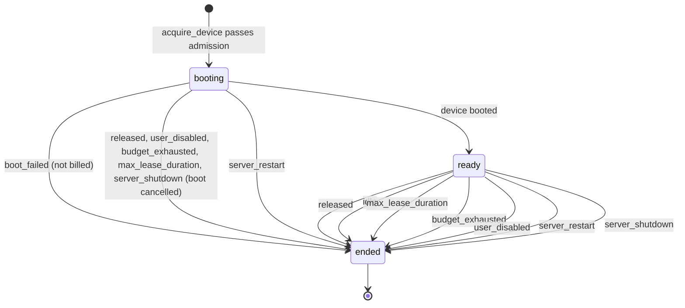

# Concepts

This document explains how Seiji lends devices to AI agents and how it limits that use. It defines users and seats, tenant accounts, leases and their lifecycle, devices, quotas and the budget, capacity and admission, the reaper, builds, recorded runs and their evidence, isolation modes and the Maestro integration. The terms are in the [glossary](glossary.md). [architecture.md](architecture.md) shows how the components implement these concepts.

## Contents

- [Users and seats](#users-and-seats)
- [Tenant accounts](#tenant-accounts)
- [Leases](#leases)
- [Devices](#devices)
- [Quotas and budget](#quotas-and-budget)
- [Capacity and admission](#capacity-and-admission)
- [The reaper](#the-reaper)
- [Builds and retention](#builds-and-retention)
- [Runs and evidence](#runs-and-evidence)
- [Isolation modes](#isolation-modes)
- [One Maestro process per device](#one-maestro-process-per-device)
- [Driver ports](#driver-ports)

## Users and seats

A **user** is a Seiji account: a row in the `users` table with a name, a token and a quota. An agent authenticates as a user with `Authorization: Bearer <token>` on every request. All leases, builds and usage belong to one user.

| Rule | Detail |
|---|---|
| Name | 1 to 32 characters of `[a-z0-9-]`. Other names fail with "user names must be 1-32 chars of [a-z0-9-]". |
| Seats | `seats` in the config is the maximum number of users. `seiji user add` counts every user, including disabled ones. At the limit it fails with "all N seats are taken; raise `seats` in the config or remove a user". |
| Token | Shown once by `seiji user add` and `seiji user rotate-token`. Only its SHA-256 hash is stored. See [security.md](security.md#credentials). |
| Disabled | `seiji user disable` blocks the token at once (HTTP `401`). The reaper releases the user's devices at its next pass, within 15 s, with the end reason `user_disabled`. The user keeps the seat. |
| Removed | `seiji user remove` refuses while the user holds a device. It deletes the user, the user's lease history and the user's builds. The usage of that user disappears from `seiji usage`. The macOS account stays. |

[cli.md](cli.md) lists the user commands.

## Tenant accounts

With `isolation.mode: "os_user"`, each user has a **tenant account**: a macOS account named `<isolation.userPrefix><user>` (default `seiji-alice` for the user `alice`). `sudo seiji tenant provision <user>` creates it with `dscl`: hidden, not an admin, no password (`Password *`), the shell `/usr/bin/false`, primary group 20, a uid one above the highest existing uid (at least 600), and a private home (`chmod 700`). It then adds the account to the fixed group `seiji-tenants`. Nobody can log in as a tenant account. It only owns the user's simulators, emulators, Maestro processes and files.

`seiji tenant provision` run again for an existing tenant account repairs it. It refuses an existing account that is not a tenant account ("already exists and is not a Seiji tenant account; refusing to change it").

`seiji user add` stores the tenant account name in the user's row. Under `os_user` it refuses a user whose tenant account does not exist or does not pass the root helper checks ("run `sudo seiji tenant provision <user>` first").

With `isolation.mode: "shared"`, users have no tenant account. Everything runs as the **daemon account** `seiji`.

## Leases

A **lease** is one user's hold on one device. Its id is `l_` plus 12 hex characters (for example `l_3f9a1c0b7e2d`). The `leases` table is also the usage ledger: the budget is computed from it.

A lease has three states:

| State | Meaning |
|---|---|
| `booting` | Admission created the lease. Seiji creates and boots the device. The user is billed from this moment. |
| `ready` | The device booted. The lease accepts the lease operations: `install_app`, the device tools (`uninstall_app`, `launch_app`, `terminate_app`, `open_url`, `configure_device`, `push_notification`, `get_logs`), `inspect_screen`, `take_screenshot` and the run tools (`run_actions`, `run_xctest`, `run_flow`). |
| `ended` | The device is deleted. `ended_at` and the end reason are set. The lease never changes again. |



| End reason | Set by | Billed |
|---|---|---|
| `released` | `release_device` | yes |
| `idle` | the reaper: no lease operation for `idleMinutes` | yes |
| `max_lease_duration` | the reaper: the lease is older than `maxLeaseMinutes` | yes |
| `budget_exhausted` | the reaper: the user used all `monthlyMinutes` of the month | yes |
| `user_disabled` | the reaper: an admin disabled the user | yes |
| `boot_failed` | `acquire_device`: create or boot failed | no |
| `server_restart` | `seiji serve` at start: the lease was active when the previous process stopped | yes |
| `server_shutdown` | `seiji serve` at SIGTERM or Ctrl-C | yes |

A release of a `booting` lease (by `release_device`, the reaper or the shutdown) cancels the boot. The lease ends with the reason of the release and is billed, so an acquire followed by a release during the boot is not free. `acquire_device` then returns "the lease was released while the device booted". Only a real failure of create or boot gives `boot_failed`.

A `server_restart` lease ends at its last recorded activity (`last_activity_at`, or `started_at` if that is later), because the time of the crash is unknown. The time while `seiji serve` was down is not billed.

The lease result of `acquire_device` and `budget_status` has `ends_at_latest` (`started_at + maxLeaseMinutes × 60`) and `idle_release_minutes`. [mcp.md](mcp.md) gives the fields.

## Devices

A **device** is an iOS simulator or an Android emulator. Seiji creates a fresh device for each lease and deletes it at release. Nothing that one lease installs or types reaches another lease.

| Platform | Created with | Device id | Deleted with |
|---|---|---|---|
| iOS | `xcrun simctl create seiji-<lease id> <deviceType> <runtime>` | the simulator UDID | `simctl shutdown`, then `simctl delete` |
| Android | `emulator -avd <avd> -port <console port> -read-only -no-window -no-snapshot-save` plus `android.emulatorArgs` | `emulator-<console port>` | `adb emu kill`, then a kill of the emulator's process group after 15 s |

- The name prefix `seiji-` marks the simulators that Seiji owns. At start, Seiji deletes every simulator with this prefix in each account's device set (orphans of a crash). It never deletes another simulator.
- Android emulators start with `-read-only`, so they never write the AVD in `android.avdHome`. All users share the AVDs, and each lease discards its changes.
- Each lease has a **lease dir**, `<workspace>/leases/<lease id>`. It holds the copied builds, the tenant's half of each [run](#runs-and-evidence) in progress (`runs/<run id>/`), and the screenshots in progress. Seiji deletes it at release.
- Booting has a deadline: `ios.bootTimeoutSeconds` (default 180) and `android.bootTimeoutSeconds` (default 240).
- On iOS, `inspect_screen` reads the accessibility tree with AXe `describe-ui`. On Android it runs `maestro hierarchy`.
- The device tools, `run_actions` and `run_xctest` work on iOS simulators only. On an Android lease they fail with "`<tool>` supports iOS simulators only for now" (for example "run_actions supports iOS simulators only for now"). `run_flow`, `inspect_screen` and `take_screenshot` work on both platforms.

[configuration.md](configuration.md) describes the device models.

## Quotas and budget

Each user has a **quota** of four values. `defaultQuota` in the config is the quota of a new user. `seiji user add` and `seiji user set` can change each value.

| Quota key | Meaning | Enforced by |
|---|---|---|
| `monthlyMinutes` | The **budget**: device-minutes for each UTC calendar month. `0` blocks all devices. | admission and the reaper |
| `maxConcurrent` | Devices the user holds at the same time, iOS and Android together. | admission |
| `maxLeaseMinutes` | The maximum wall-clock length of one lease, boot included. | the reaper |
| `idleMinutes` | The time without a lease operation after which the reaper releases a `ready` lease. | the reaper |

A change of quota takes effect at the next admission and the next reaper pass.

### Device-minutes

A **device-minute** is one minute that one lease exists. The clock starts at admission (`started_at`, so boot time counts: a booting device holds host memory and CPU) and stops at `ended_at`. A lease that is still active counts up to now. A lease with `boot_failed` has `billable = 0` and counts nothing.

### The month window

The budget window is the UTC calendar month: from 00:00 UTC on the first day to 00:00 UTC on the first day of the next month. The budget resets at that moment. A lease that spans two months is clipped: each month counts only its own part.

The usage of a user in a window `[from, to)` is the sum, over the user's billable leases that overlap the window, of:

```text
max(0, min(ended_at or now, to) − max(started_at, from))   seconds
```

`seiji usage` uses the same sum for the current month or `--month YYYY-MM`.

### `budget_status`

`Pool::budget` computes the budget result from that sum for the current month:

| Field | Value |
|---|---|
| `used_minutes` | used seconds ÷ 60, rounded to 0.1 |
| `remaining_minutes` | `max(0, monthlyMinutes − used minutes)`, rounded to 0.1 |
| `estimated_cost_usd` | used minutes ÷ 60 × `costPerDeviceHourUsd`, rounded to 0.01. The field is absent when `costPerDeviceHourUsd` is not set. |
| `month` | the current month as `YYYY-MM` (UTC) |

`costPerDeviceHourUsd` only splits the cost of the host between users. An EC2 Mac dedicated host has a 24-hour minimum allocation (the Apple macOS license), so the host cost is fixed whether devices run or not.

## Capacity and admission

**Capacity** is the host-wide limit of simultaneous devices for each platform: `capacity.ios` and `capacity.android`. A platform without its config section (`ios` or `android`) has capacity 0.

**Admission** is the check that creates a lease. `acquire_device` runs it in this order:

1. Resolve the model: the `model` argument, or the platform's `defaultModel`. Fail with `android is not available on this host` (or `ios ...`) when the platform is not configured, or `unknown ios model "x"; available: [...]` when the model is not in the config.
2. Take the **admission lock**. The steps below run under it, so two calls cannot both take the last slot.
3. Read the user again. Fail when the user is gone (`user no longer exists`) or disabled (`user "alice" is disabled`).
4. Budget: fail when the used seconds of the month are at least `monthlyMinutes × 60` (`monthly budget exhausted: 1200.0 of 1200 device-minutes used in 2026-11`).
5. Concurrency: fail when the user's active leases (`booting` or `ready`, both platforms) are at least `maxConcurrent` (`you already hold 2 device(s), your limit is 2; release one first`).
6. Capacity: fail when the platform's active leases are at least its capacity (`host is full: 12/12 ios devices in use; try again later`).
7. Ports: pick a free TCP port on `127.0.0.1` that no active lease uses as the [driver port](#driver-ports). For Android, also pick the first even **console port** `p` in `android.consolePortRange` where `p` and `p + 1` are free and unused ("no free emulator console port in android.consolePortRange").
8. Resolve the user's account. Under `os_user` the tenant account must exist (`` macOS account "seiji-alice" is missing; run `sudo seiji tenant provision` ``). A failure here leaves no lease.
9. Insert the lease as `booting`, take the lease's op lock before any other call can see the lease, and release the admission lock.

Create and boot run after the admission lock is released, so a slow boot does not block other users' admissions. They run under the lease's op lock, so a release that arrives during the boot waits until the boot stops and then finds the device.

Seiji has no queue. A failed admission returns an error at once. The agent must retry later.

Admission does not reserve budget. A user with one minute left can start a lease. The reaper then releases it when the budget is used up, so a user can exceed the budget by up to one reaper interval for each lease.

## The reaper

The **reaper** is a loop that runs every 15 s in `seiji serve`. Each pass:

1. Deletes the builds that are older than `appRetentionHours` (see [Builds and retention](#builds-and-retention)), then the runs that ended more than `evidence.retentionHours` ago (see [Retention](#retention)).
2. For each active lease, picks the first end reason that applies, in this order, and releases the lease:

| Order | End reason | Condition | Applies to |
|---|---|---|---|
| 1 | `user_disabled` | the user is disabled | `booting` and `ready` |
| 2 | `budget_exhausted` | the user's used seconds of the month ≥ `monthlyMinutes × 60` | `booting` and `ready` |
| 3 | `max_lease_duration` | now − `started_at` ≥ `maxLeaseMinutes × 60` | `booting` and `ready` |
| 4 | `idle` | now − `last_activity_at` ≥ `idleMinutes × 60`, and no operation runs on the lease | `ready` only |

- When the budget is used up, every active lease of the user ends in the same pass.
- A `booting` lease that the reaper releases ends with the reaper's reason and is billed (see [Leases](#leases)).
- A release cancels the operation that runs on the lease. A running Maestro flow or `xcodebuild` is killed. A run then stops its steps, but still collects its evidence before the release deletes the device (see [Runs and evidence](#runs-and-evidence)).
- A running operation is never idle. The reaper skips the idle check while the lease's [op lock](#one-maestro-process-per-device) is held.
- Activity means a lease operation (see the `ready` state in [Leases](#leases)). Each one sets `last_activity_at` before it starts and after it ends. `budget_status`, `list_device_models`, `list_runs`, `get_run`, `get_run_artifact`, `export_evidence` and `cheat_sheet` do not count.
- The idle clock starts when the device is ready: the boot sets `last_activity_at` when it ends.

## Builds and retention

A **build** is an app file that a user gives Seiji to install. Its id is `a_` plus 12 hex characters. A build arrives in one of two ways:

- `POST /v1/apps` with the raw file as the body and the name in `X-Filename`. The response has the `app_id`.
- `install_app` with an `https` `url`. Seiji first checks the lease, then downloads the file and keeps it as a build too.

| Rule | Detail |
|---|---|
| Owner | A build belongs to one user. `install_app` finds only the caller's builds ("no uploaded app ..."). |
| Storage | `<dataDir>/apps/<user id>/<app_id>/<file name>`. |
| Size | At most `maxUploadBytes` (default 1 GiB) for uploads and downloads, counted while the file streams. |
| Count | At most `maxBuildsPerUser` (default 10) builds for each user at a time. Above it, an upload gets HTTP `429` and a download fails with "you already keep N builds, the limit is M; they expire Hh after upload". |
| Formats | iOS: a `.zip`, `.tar.gz` or `.tgz` that holds a simulator `.app` bundle. Android: an `.apk`. |
| Reuse | One build can be installed on any number of the user's leases. Each install copies it into the lease dir. |
| Retention | The reaper deletes a build `appRetentionHours` (default 72) after it arrived, then `install_app` fails with "no uploaded app ...". |

[mcp.md](mcp.md#http-api) gives the upload interface.

## Runs and evidence

A **run** is one recorded test on a lease's device. Its id is `r_` plus 12 hex characters. A run keeps **evidence**: the files that it records, and a **manifest** that describes the run and lists every file with its SHA-256. Three tools start a run:

| Tool | Kind | Platforms | What runs | Step records come from |
|---|---|---|---|---|
| `run_actions` | `actions` | iOS | A list of [steps](#steps), executed one by one by Seiji through AXe and `simctl`. | Seiji's own step records. |
| `run_xctest` | `xctest` | iOS | `xcodebuild test-without-building` on a `build-for-testing` bundle that the user uploaded as a [build](#builds-and-retention) (a `.zip` or `.tar.gz` of the `Products` folder). Only when `xctest.enabled` is `true` (the default), otherwise "run_xctest is turned off on this host (xctest.enabled)". | `xcrun xcresulttool get test-results tests`: one record for each test case. |
| `run_flow` | `flow` | iOS and Android | `maestro test` on inline YAML. Only when `maestro` is in the config, otherwise "Maestro is not configured on this host (`maestro` in seiji.json)". | Maestro's `commands-*.json` debug files: one record for each Maestro command. |

Seiji checks the input before a run starts: the actions, the `run_flow` `env` keys (`env key "<k>" must match [A-Za-z0-9_]+`, at most 128 characters), the XCTest options, the run options (`name` 1 to 200 characters, at most 10 `tags` of `[A-Za-z0-9_-]`, `log_predicate` 1 to 2000 characters) and the [evidence quota](#evidence-quota-and-run-budget). A refused call creates no run. For example, an invalid action fails with "action 2 (screenshot): ..." and nothing reaches the device.

A run needs a `ready` lease of the caller and runs under the lease's [op lock](#one-maestro-process-per-device), so a run and any other operation on the same device never overlap.

### Run status

A run is `running` while it executes. Then it ends with one status and a one-line **verdict**:

| Status | `actions` | `flow` | `xctest` |
|---|---|---|---|
| `passed` | Every step passed ("7 of 7 steps passed"). | `maestro test` exited 0 ("the flow passed"). | `xcodebuild` exited 0. |
| `failed` | At least one step failed ("step 2 (tap) failed: ..."), or `evidence.maxRunSeconds` passed between two steps ("5 of 7 steps ran: the run reached evidence.maxRunSeconds"). | Maestro exited with another code ("the flow failed (exit 1): `<last output line>`") or timed out at `maestro.flowTimeoutSeconds` ("the flow timed out (maestro.flowTimeoutSeconds)"). | `xcodebuild` exited 65 (tests failed) or timed out at `xctest.timeoutSeconds` ("xcodebuild timed out (xctest.timeoutSeconds)"). |
| `error` | Recording the evidence failed. | The flow could not start, or recording the evidence failed. | The bundle could not be copied in, the script exited with another code or a signal, for example 2 when the bundle has no `.xctestrun` file ("xcodebuild exited 2: ..."), or recording the evidence failed. |
| `cancelled` | The lease was released during the run. | The lease was released during the run. | The lease was released during the run. |

- `cancelled` means only that the lease was released. A run that passed stays `passed`. Otherwise the verdict starts with "the lease was released during the run: ", or is "the lease was released" when the engine already said so.
- For `xctest` with exit code 0 or 65, the verdict counts the test cases: "2 tests: 1 passed, 1 failed, 0 skipped".
- When the copy, the hashing or the manifest of a run fails after the run started, Seiji closes the run with an `error` manifest (the warning "recording the run failed", the files that exist) and `finish_run`. The tool fails with `run <run id> failed while recording its evidence: ...`.
- A run that was `running` when `seiji serve` stopped gets the same `error` manifest at the next start, with the verdict "server restarted during the run" and the warning "the server restarted during the run; only files written before that are kept" (see [architecture.md](architecture.md#startup-recovery)). No run stays `running`.
- The tool result is a summary of the run: `run_id`, `status`, `verdict`, the steps, the file count, `manifest_sha256` and the `evidence_zip` link. A status other than `passed` sets `isError: true`. A `failed` or `error` run also attaches a JPEG of the screen at the end of the run (longest side 2000 px or less). This JPEG is not part of the evidence. [mcp.md](mcp.md) gives the fields.

### Steps

A **step** is one action of `run_actions`, written as an object with one key, for example `{"tap": {"label": "Sign In"}}`. A call takes 1 to `evidence.maxSteps` (default 200) actions ("run_actions takes 1-200 actions"). [mcp.md](mcp.md) lists the actions and their arguments.

The steps run in this order:

1. Steps run one by one, in the given order. Each AXe command has a timeout of `axe.stepTimeoutSeconds` (default 60).
2. A failed step stops the run. The remaining steps are `skipped` with the error "an earlier step failed".
3. With `continue_on_error: true`, the remaining steps still run. The verdict names the first failed step and counts the others ("(+2 more)").
4. A release skips the remaining steps ("the lease was released"). A step that runs at that moment fails with the same error.
5. `evidence.maxRunSeconds` (default 1800) bounds the whole run. A step that runs past it fails, and the steps after it are skipped ("the run reached evidence.maxRunSeconds"). When the time runs out between two steps, no step fails, but the run is still `failed`.

Each step record has `index` (from 0), `action` (with secrets [redacted](#secrets)), `status` (`passed`, `failed` or `skipped`), `started_ms` (from the start of the run), `duration_ms`, `error` and `files`. The manifest drops `null` fields from the stored actions and steps.

Waits and assertions:

| Action | Timing |
|---|---|
| `tap` with a selector | AXe waits up to `timeout_seconds` (default 5, at most 30) for the element. |
| `wait_for` | Seiji reads the accessibility tree every 0.5 s until the element is on screen (or gone, with `gone: true`), up to `timeout_seconds` (default 10, at most 120). |
| `assert_visible`, `assert_not_visible` | The same poll with a fixed 2 s for the screen to settle. |
| `sleep` | `seconds`, at most 60. |
| `scroll` with `until` | At most `max_swipes` swipes (default 10, at most 50) until the element is on screen. `max_swipes` without `until` is refused ("scroll: max_swipes needs until"). |

A wait that runs out fails with the selector and the time, for example `label="Welcome" is not on screen after 10.0s` or `id="spinner" is still on screen after 2.0s`.

### Selectors

A **selector** names an element on screen. Seiji matches it against the accessibility tree that AXe `describe-ui` returns. Every given field must match the same node.

| Field | Matches |
|---|---|
| `id` | `AXUniqueId` or `AXIdentifier`, exactly. |
| `label` | `AXLabel`, exactly. |
| `value` | `AXValue`, exactly. |
| `contains` | A case-insensitive substring of the label, the value or the title. Not accepted by `tap`. |
| `element_type` | Narrows the match to one type, for example `Button`, `TextField` or `Switch`. Case-insensitive; `Button` also matches `AXButton`. |

- A selector needs one of `id`, `label`, `value` or `contains` ("a selector needs one of id, label, value or contains").
- `tap` takes exactly one of `id`, `label` or `value`, or both `x` and `y` ("tap needs exactly one of id, label or value, or both x and y"). AXe itself finds the element for a tap.
- `scroll` `until` takes exactly one of `id` or `label`, and no other field ("scroll: until needs exactly one of id or label, and nothing else").
- `inspect_screen` on iOS shows the same tree, one line for each node with a label, id or value, so the agent can copy exact selectors.

### What a run records

A run writes its files under stable relative paths:

| File | Recorded for | Content |
|---|---|---|
| `video.mp4` | iOS runs with `record_video` (default `true`) | The screen, from `simctl io <udid> recordVideo --codec=h264`. Seiji stops it with SIGINT, so the movie is complete. |
| `app.log` | iOS runs with `capture_logs` (default `true`) | Unified-log lines from `simctl spawn <udid> log stream --style compact --level debug`, filtered by `log_predicate` or, by default, `process == "<executable>" OR subsystem BEGINSWITH "<bundle id>"` of the installed app. |
| `crashes/<executable>-*.ips` | iOS runs with an installed app | The crash reports of the app that the account's `~/Library/Logs/DiagnosticReports` received during the run. |
| `steps/<NNN>-<action>.png` | `run_actions` with `screenshot_each_step` (default `true`) | A full-resolution PNG after each step, except `screenshot` steps, which save only their named file. `NNN` is the step index with three digits. |
| `steps/<NNN>-<action>-failure.png` | each failed step, always | The screen at the failure. |
| `steps/<NNN>-<action>-tree.txt` | each failed step, always | The accessibility tree at the failure, one line for each node. |
| `steps/<NNN>-screenshot-<name>.png` | the `screenshot` action | A named screenshot. |
| `steps/<NNN>-capture_tree-<name>.json` | the `capture_tree` action | The raw AXe tree. |
| `xctest/xcodebuild.log`, `xctest/output-tail.txt` | `run_xctest` | The full `xcodebuild` output and its last lines. |
| `xctest/result.xcresult.zip` | `run_xctest` | The result bundle, zipped with `ditto`. |
| `xctest/xcresult-summary.json`, `xctest/xcresult-tests.json` | `run_xctest` | `xcresulttool get test-results summary` and `tests`. |
| `xctest/attachments/...` | `run_xctest` | `xcresulttool export attachments`: the screenshots and files that the tests attached. |
| `flow.yaml`, `maestro/report.xml`, `maestro/debug/...`, `maestro/output/...`, `maestro/output.txt` | `run_flow` | The flow, the JUnit report, Maestro's debug output (screenshots and `commands-*.json`), its test output and its console output. |

- Video, `app.log` and crash reports are iOS only. A `run_flow` on Android records the Maestro files only.
- A capture that cannot start does not fail the run. It becomes a warning in the manifest, for example "video: ..." or "logs: no app is installed on this lease; pass log_predicate".
- Crash reports need the app's executable name, so Seiji collects them only when `install_app` installed the app on this lease.

### The manifest

Each run has `manifest.json` with the schema `seiji.run.v1`:

| Field | Value |
|---|---|
| `schema` | `seiji.run.v1` |
| `run_id`, `kind`, `name`, `tags` | The run and its options. `kind` is `actions`, `flow` or `xctest`. |
| `status`, `verdict` | See [Run status](#run-status). |
| `user`, `lease_id` | The owner and the lease. |
| `device` | `platform`, `model`, `udid`, and for iOS `device_type` and `runtime` from the config. |
| `app` | The installed app: `filename`, `bundle_id`, `executable`, `version`. Absent when no app is installed. |
| `started_at`, `ended_at` | Unix seconds. |
| `seiji_version` | The version of `seiji serve`. |
| `input` | What the run executed: the actions, the flow YAML with `env_keys`, or the XCTest options. |
| `steps` | The step records. |
| `files` | Every file of the run with `path`, `bytes` and `sha256`, sorted by path. `manifest.json` itself is not listed. |
| `dropped` | Files that the run did not keep because of its byte budget. |
| `warnings` | Problems while collecting evidence that did not fail the run. |

The tool result and `export_evidence` give the SHA-256 of `manifest.json` itself (`manifest_sha256`). That one hash pins the hash of every file. The hashes show that the files did not change after Seiji stored them. They do not show who wrote a tenant file: see [security.md](security.md#recorded-runs-and-evidence).

`export_evidence` (and `GET /v1/runs/{run_id}/report.md`) turns the manifest into Markdown for a pull request: the verdict, the device, the app, a table of the steps, links to the video, the log, the crash reports, the failure screenshots and the `.xcresult`, and the link to `evidence.zip`.

### Evidence quota and run budget

| Limit | Default | Rule |
|---|---|---|
| `evidence.maxBytesPerUser` | 5 GiB | The **evidence quota**, at least 1 byte. A new run fails when the user's kept runs plus the budgets reserved by the user's running runs reach it: "evidence quota full: N of M bytes kept or reserved by running runs; runs expire Hh after they end". |
| `evidence.maxRunBytes` | 2 GiB | The most that one run keeps. |
| run byte budget | — | The smaller of `evidence.maxRunBytes` and the rest of the evidence quota, fixed and reserved when the run starts. The reservation ends when the run ends, however it ends. |

- `app.log` above half the budget is cut to half the budget, with the warning "app.log was cut to N bytes".
- Files that do not fit in the rest of the budget are not kept. Their paths are in `dropped`, and the Markdown summary says how many.
- The run's size is the size of its files at the end. It counts against the quota until the run expires. A run closed with `error` (recording failure or restart) counts its files too.

### Retention

The reaper deletes a run and its files `evidence.retentionHours` (default 168) after the run ended. A run outlives its lease: the evidence stays after the release. After the deletion, `get_run` fails with `no run "r_..." for you`.

### The installed app

A lease remembers the app that `install_app` installed last on it: its file name and, on iOS, the `CFBundleIdentifier`, `CFBundleExecutable` and `CFBundleShortVersionString` from its `Info.plist`.

- `bundle_id` defaults to that app in the `launch_app` and `terminate_app` actions and in `uninstall_app`, `launch_app`, `terminate_app`, `configure_device` permissions and `push_notification`. Without one, the call fails with "no bundle_id given and no app installed on this lease".
- The default log predicate of `app.log` and `get_logs` and the crash report search use that app. Without it, `get_logs` with no `predicate` fails with "no app is installed on this lease; pass predicate", and a run records no `app.log` unless it gets `log_predicate`.
- `uninstall_app` of that app clears it.
- The manifest records it as `app`.

### Secrets

- A `type` step with `secret: true` is stored as `<redacted>`, in the manifest's `input` and in the step records. The text still reaches the screen: the video and the screenshots show whatever the field shows, and the app can log it.
- `run_flow` stores the YAML and only the keys of `env` (`env_keys`), not the values.
- Typed text and push payloads reach the device through stdin, not the command line. [security.md](security.md#recorded-runs-and-evidence) explains the path.

### Runs and billing

Runs do not change billing. A run happens inside a lease, and the lease is what is billed, by the minute, whether a run executes or not. Evidence counts against the evidence quota only, never against the budget.

- A run is a lease operation: it sets `last_activity_at` before and after, and the reaper never releases a lease for `idle` while a run holds the op lock.
- A run does not extend the lease. `maxLeaseMinutes`, the budget and a disabled user still release the lease during a run, and the run ends `cancelled`.
- Evidence stays after the lease ends and costs no device-minutes.

## Isolation modes

`isolation.mode` decides as whom Seiji runs the device commands (`simctl`, `emulator`, `adb`, `maestro`, `axe`, `xcodebuild`, `sips`).

| | `os_user` | `shared` |
|---|---|---|
| Runs as | the user's tenant account, through `sudo seiji exec-as` | the daemon account `seiji` |
| Simulators | in the tenant account's own CoreSimulator device set | in one device set of `seiji` |
| Workspace | `~<tenant account>/seiji` (home `700`) | `<dataDir>/tenants/<user>` |
| Processes | owned by the tenant account | owned by `seiji` |
| Separation between users | the operating system, plus Seiji | Seiji only: a token sees only its own leases and builds |
| Maestro flows and XCTest bundles can read | the tenant account's files | everything `seiji` can read |

In both modes each lease gets a fresh device, and the token decides which leases and builds a request can use.

A user keeps the tenant account name that `seiji user add` stored. A user added under `shared` has none. After a switch to `os_user`, such a user fails with `user "alice" has no macOS account`: provision the tenant account, then remove the user and add it again. Under `shared` the stored name is not used.

> **Warning:** The `os_user` path has not been tested on a real host. It runs `simctl` for a tenant account that never logged in to the GUI, through `launchctl asuser`. Run `seiji doctor <user>` on the host before you give out tokens. If it fails at `create` or `boot`, set `isolation.mode` to `"shared"`. See [troubleshooting.md](troubleshooting.md).

[architecture.md](architecture.md#privilege-chain) describes the privilege chain. [security.md](security.md) describes what each mode protects.

## One Maestro process per device

Each lease has an **op lock**. Every device operation of the lease runs under it: the boot, `install_app`, the device tools, `inspect_screen`, `take_screenshot` and every run from its first step to its manifest. So one device has at most one Maestro process, one AXe command or one `xcodebuild` at a time; two drivers on one device interfere with each other.

- A second call on the same lease waits until the first call ends. It does not fail.
- Calls on different leases run in parallel.
- A release cancels the running operation, waits for the op lock, and then deletes the device. A run that the release cancels still stops its captures and copies its evidence before it gives the op lock back.

## Driver ports

Maestro reaches its driver on the device through a host TCP port. Seiji gives each lease its own **driver port** and passes it as `--driver-host-port` on every Maestro call of the lease.

Seiji does not use `maestro mcp`. It hardcodes the iOS XCTest driver port 22087 (`McpMaestroSessionManager.DEFAULT_XCTEST_PORT`), so two iOS simulators on one host would collide on it. Seiji runs `maestro --device <device id> --driver-host-port <port> test|hierarchy` for each Maestro operation instead, so any number of leases run flows at the same time.

Android emulators have one more port pair: the even **console port** from `android.consolePortRange` (the emulator's `-port`) and the adb port above it. Maestro hardcodes the adb server port 5037, so all Android emulators share one adb server. [security.md](security.md#android-and-the-shared-adb-server) explains the effect.
