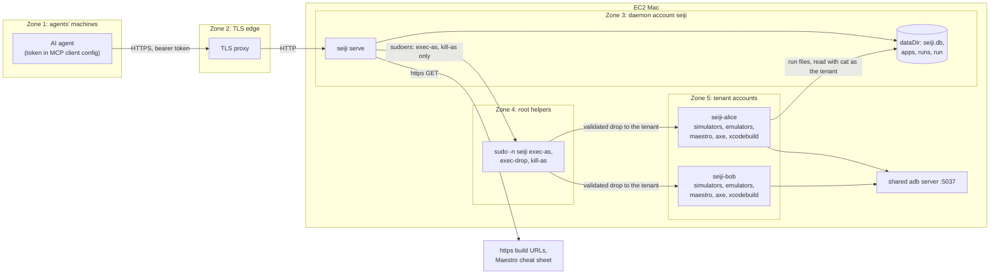

# Security model

This document describes the trust boundaries of Seiji, the path of each credential, the invariants of the root helpers, the file and network exposure, the risks of Maestro flows, XCTest bundles and builds, the handling of recorded evidence, the viewer, the tunnels of `seiji forward`, and the known limits. To report a vulnerability, follow [SECURITY.md](../SECURITY.md).

## Contents

- [Trust boundaries](#trust-boundaries)
- [Credentials](#credentials)
- [Root helper invariants](#root-helper-invariants)
- [The daemon account](#the-daemon-account)
- [Filesystem layout and permissions](#filesystem-layout-and-permissions)
- [Network exposure](#network-exposure)
- [Maestro flows](#maestro-flows)
- [Recorded runs and evidence](#recorded-runs-and-evidence)
- [Android and the shared adb server](#android-and-the-shared-adb-server)
- [Uploads and downloads](#uploads-and-downloads)
- [The viewer](#the-viewer)
- [Tunnels (`seiji forward`)](#tunnels-seiji-forward)
- [Known limits](#known-limits)
- [Operator checklist](#operator-checklist)

## Trust boundaries

Seiji treats the agent's input as untrusted: tool arguments, actions, flow YAML, flow variables, builds, XCTest bundles and build URLs. It also treats every file that a tenant account writes into a run as untrusted. The daemon account holds the database, the evidence and the right to act as any tenant account. The root helpers hold root, and use it only to become a tenant account.



| Boundary | Control |
|---|---|
| Agent → edge | TLS at the proxy. Seiji itself serves plain HTTP. |
| Edge → daemon | A bearer token on `/mcp`, `POST /v1/apps`, `GET /v1/runs/{run_id}/...`, `GET /v1/me`, `/v1/admin/...` and `/v1/leases/{lease_id}/...`. A missing, unknown or disabled token gets `401`. The admin endpoints (`GET /v1/admin/users`, `PUT /v1/admin/users/{id}/limits`) also require the user's name to be in `adminUsers`; non-admin users get `403`. Admin authority comes only from the operator-controlled config, never from client-supplied flags. No endpoint grants or changes roles, creates users, reveals tokens or changes global host capacity. `/mcp` checks the `Host` header against `listen.allowedHosts`. `POST /v1/apps` has a body limit of `maxUploadBytes`. The viewer routes (`/view/...`) use a session cookie instead of the token (see [The viewer](#the-viewer)). `GET /healthz` is open. |
| User → user (in Seiji) | Every lease operation checks that the lease belongs to the caller ("no active lease ... for you"). A build is found by id and owner together ("no uploaded app ..."). A run is found by id and owner together (`no run "r_..." for you`, HTTP `404` on the downloads). |
| Daemon → root | sudoers allows `seiji` to run only `seiji exec-as *` and `seiji kill-as *`, with `-n` and `env_reset`. The helpers never read the config. They refuse every account that is not a valid tenant account. |
| Root → tenant | `exec-drop` drops to the tenant account and checks that the drop stuck. The pidfile is written as the tenant account. `kill-as` signals as the tenant account. |
| Tenant → tenant | `os_user` only: separate macOS accounts, homes with mode `700`, separate CoreSimulator device sets, separate process ownership. This does not cover the shared adb server or the loopback ports of other devices. |
| Tenant → daemon data | Builds, flows, typed text and push payloads reach the tenant account as a file descriptor on stdin. A tenant account never needs to read `<dataDir>/apps`. Run files travel the other way: Seiji reads them with `cat` as the tenant account, cleans their paths and bounds their size (see [Recorded runs and evidence](#recorded-runs-and-evidence)). |
| Daemon → internet | Build downloads accept only `https`, for the URL and every redirect (at most 5), with a 600 s timeout. The host is not restricted. The cheat sheet comes from one fixed `https` URL. |

## Credentials

| Credential | Stored in | Used by | Shown |
|---|---|---|---|
| User token | `users.token_hash`: the SHA-256 (hex) of the token only. The plaintext is in the agent's MCP client config, and on a developer's Mac in the login keychain after `seiji login`. | the auth middleware | Once, by `seiji user add` or `seiji user rotate-token`. |
| Client token on a developer's Mac | `seiji login` stores it in the macOS login keychain: a generic password with service `seiji` and the server URL as account. `~/Library/Application Support/seiji/client.json` holds only `{url, user}`, no token. `seiji logout` deletes both. | `seiji token print`, the Tern plugin | `seiji token print` prints it on request. |
| Viewer ticket | Server memory only. 64 hex characters, single use, valid 60 s. | `GET /view/open/{ticket}` | In the viewer link, once. |
| Viewer session secret | Server memory: only its SHA-256. The browser keeps it in the `seiji_view` cookie. | every `/view/s/{sid}/...` request | Never; it is set as an `HttpOnly` cookie. |
| Tenant account password | None is assigned. `seiji tenant provision` disables authentication with `AuthenticationAuthority ;DisabledUser;` and uses the shell `/usr/bin/false`. No password appears on any command line. | nobody | — |
| TLS certificate and key | The TLS proxy. | the proxy | — |

Tokens:

- Format: `sj_` plus 43 URL-safe base64 characters (32 random bytes, no padding).
- The server hashes the presented token and looks up the hash. It never stores or logs the plaintext. The auth middleware logs only database errors.
- `seiji user rotate-token <user>` makes a new token. The old token stops working at the next request.
- `seiji user disable <user>` refuses the token at once and releases the user's devices within 15 s.
- A token has no expiry and no role. Every user has the same 23 tools. User management needs the `seiji` CLI on the host with access to the database.
- Seiji has no rate limit on failed authentications. A random 256-bit token is not practical to guess. Add rate limits at the proxy if you need them.
- Agent clients keep the token in their MCP config (for example the `--header` of `claude mcp add`). Treat that file as a secret. [mcp.md](mcp.md#client-setup) shows the client setup.
- On a developer's Mac, `seiji login --url <server>` reads the token from stdin (no echo on a terminal), checks it with `GET /v1/me`, and stores it in the login keychain. `seiji token print` gives it to the Tern plugin, which keeps it in memory only. `SEIJI_URL` and `SEIJI_TOKEN` override the keychain; use them only in CI and tests. See [cli.md](cli.md#seiji-login).

## Root helper invariants

The root helpers are `seiji exec-as`, `seiji exec-drop` and `seiji kill-as`. They run as root through sudo. Their code is in `src/tenant.rs`.

| Invariant | Why |
|---|---|
| They never read the config. | The daemon account can write its own data, and maybe the config. Root must not trust anything that the daemon controls about who counts as a tenant. |
| The tenant group is fixed: `seiji-tenants`. It is not configurable. | Same reason. Only an admin can change group membership. |
| The target account must exist, have uid 501 or higher, be in `seiji-tenants`, and not be in the admin group (gid 80). `exec-as` and `exec-drop` both check. | The daemon can never become root, a system account or an admin. |
| They require an effective uid of 0 ("must run as root (through sudo)"). | They run only through sudo. |
| `exec-drop` clears the environment. It sets `HOME`, `USER`, `LOGNAME`, `SHELL`, `PATH`, and then each `--env KEY=VALUE`. | No root or daemon environment reaches the tenant process unless the daemon names it. |
| After `initgroups`, `setgid` and `setuid`, `setuid(0)` must fail and the effective uid and gid must be the tenant's. Otherwise: "privilege drop did not stick". `exec-drop` and `kill-as` use the same drop. | A partial drop never runs a program or sends a signal. |
| `exec-drop` changes to the working directory (`--cwd`, or the home) after the drop. | The daemon chooses the path. The kernel checks it against the tenant's rights, not root's. |
| The pidfile is written after the drop, as the tenant account, with mode `0644`. Then the umask becomes `077`. | The daemon chooses the path. Root writing it would let the daemon overwrite any file. The program's own files stay private to the tenant account. |
| `kill-as` refuses a pgid of 1 or less, drops to the tenant account, then calls `killpg`. | The kernel lets it reach only that account's processes. |
| The binary is owned by root and not writable by `seiji` (`install -o root -g wheel -m 755`). `isolation.helper` names the same path as sudoers. | sudoers runs this file as root. If `seiji` could replace it, `seiji` would be root. |

`seiji tenant provision` is the exception: an admin runs it with sudo, and it reads the config for `isolation.userPrefix`. It accepts only names of `[A-Za-z0-9_-]`. It creates the group if needed. For a new name, it creates the account with `dscl`: the shell `/usr/bin/false`, the uid one above the highest existing uid (at least 600), primary group 20, and the home `/Users/<account>`, and adds it to `seiji-tenants`. For both new and existing tenants, it disables authentication with `AuthenticationAuthority ;DisabledUser;`, hides the account and sets the home to mode `700`. It does not write the protected `Password` attribute, which current macOS rejects with `eDSPermissionError`. It refuses an existing account that is not already a tenant account ("already exists and is not a Seiji tenant account; refusing to change it"), so it never takes over a person's account.

## The daemon account

`seiji serve` runs as the unprivileged, hidden account `seiji`.

| The daemon account can | The daemon account cannot |
|---|---|
| Run any program, with any arguments, environment variables and working directory, as any tenant account. | Run anything as root except `exec-as` and `kill-as`. |
| Send any signal to any process group of a tenant account. | Act as an admin, a system account (uid below 501), or any account outside `seiji-tenants`. |
| Read and write `<dataDir>`: the database, all builds, all evidence, the logs. | Read a tenant account's home directly (mode `700`). It goes through `exec-as`. |
| Add, change and remove users in the database. | Signal a process of another account. |
| Make outbound network connections. | |

So a compromise of the daemon account is a compromise of every tenant account and every user's data. It is not a compromise of root or of the admin accounts.

## Filesystem layout and permissions

| Path | Owner | Mode | Notes |
|---|---|---|---|
| `/usr/local/bin/seiji` | root:wheel | `755` | sudoers runs it as root. Never writable by `seiji`. |
| `/etc/sudoers.d/seiji` | root | `440` | From `deploy/sudoers.seiji`. Check it with `visudo -cf`. |
| `/usr/local/etc/seiji/seiji.json` | admin's choice | admin's choice | Read by `seiji serve`, the CLI and `seiji tenant provision`. Not by the root helpers. |
| `<dataDir>` | `seiji` | `0711`, set at every start | Others cannot list it. Tenant accounts can pass through it to reach `run/pids`. |
| `<dataDir>/seiji.db` | `seiji` | private (umask `077`) | Users, token hashes, leases, builds, runs. |
| `<dataDir>/apps/` | `seiji` | private (umask `077`) | All users' builds. Only the daemon account reads them. |
| `<dataDir>/runs/` | `seiji` | private (umask `077`) | All users' evidence, in `<user id>/<run id>/`. Only the daemon account reads it. |
| `<dataDir>/run/` | `seiji` | `0711`, set at every start | Files in transit, all private (umask `077`): flow YAML, typed text, push payloads, `evidence.zip` builds, JPEG previews, capture and emulator logs. Others cannot list it. |
| `<dataDir>/run/pids/` | `seiji` | `1733`, set at every start | Tenant accounts create pidfiles. They cannot list the directory or remove another account's file. |
| `/Users/<tenant account>` | tenant account | `700`, set by `seiji tenant provision` | Other tenant accounts and `seiji` cannot read it. |
| `~<tenant account>/seiji/leases/<lease id>` | tenant account | private (umask `077` of `exec-drop`) | The lease dir, with the tenant run dirs (`runs/<run id>/`) of runs in progress. Deleted at release. |
| `<dataDir>/tenants/<user>` | `seiji` | private (umask `077`) | The workspace under `shared`. |

Every `seiji` command except the root helpers sets the umask to `077`. `Runner::new` then opens up only `<dataDir>` and `<dataDir>/run` (`0711`) and `run/pids` (`1733`). The umask does not change files that already exist; step 5 of the [operator checklist](#operator-checklist) checks them.

Builds are copied in through stdin. Under `os_user` the daemon cannot write into a tenant home. It opens the build itself and passes the file descriptor as stdin to `/bin/sh -c 'set -e; rm -rf "$1"; mkdir -p "$1"; cat > "$2"'`, which runs as the tenant account. Flow YAML takes the same path. Typed text and push payloads are stdin of `axe` and `simctl` directly (see [Typed text and payloads](#typed-text-and-payloads)). Arguments reach the shell as `$1` and `$2`, never interpolated into the script.

## Network exposure

- `seiji serve` listens on `listen.host:listen.port` (default `127.0.0.1:4780`) with plain HTTP. `deploy/seiji.example.json` uses `0.0.0.0`. With a TLS proxy on the same host, use `127.0.0.1`. Otherwise allow the port only from the proxy.
- Put TLS in front: Caddy, nginx, an ALB or Tailscale. Seiji has no TLS.
- `listen.allowedHosts` is a DNS-rebinding guard. The MCP service accepts only requests whose `Host` header is in the list (default `localhost`, `127.0.0.1`). Add your public hostname. The check covers `/mcp` only; `POST /v1/apps` and `GET /v1/runs/...` need the token in any case.
- `GET /healthz` needs no token and returns `ok`.
- A tool call holds its HTTP request open for its whole length. The response is an SSE stream with keepalive comments every 15 s, so the proxy needs only an idle read timeout above 15 s. The absolute operation time does not matter for timeouts.
- Outbound connections: build downloads (`install_app` with `url`), and `https://api.copilot.mobile.dev/v2/bot/maestro-cheat-sheet` at the first `cheat_sheet` call of the process.
- Driver ports, emulator console ports, the adb server and open tunnels are TCP ports on the host. Seiji does not authenticate them. Any local process can connect to them.

## Maestro flows

A flow is code that the agent writes. Seiji runs it with `maestro test` as the tenant account (`os_user`) or as the daemon account (`shared`).

- Maestro commands that take a path read files as that account: `runFlow` and `runScript` with a file, and `addMedia`. Absolute paths work.
- Under `shared`, a flow can read everything that `seiji` can read: every user's builds, every user's lease dirs, every user's evidence in `<dataDir>/runs`, and the database. For example, `addMedia` can put another user's file into the caller's simulator, where a screenshot shows it. Use `shared` only for users who trust each other.
- Under `os_user`, a flow can read the tenant account's own files and whatever is readable by every account on the host.
- A flow runs on the host's network. Maestro's JavaScript (`runScript`, `evalScript`) has an HTTP client, so a flow can reach your VPC and the EC2 instance metadata service at `169.254.169.254`. Give the instance no IAM role, or a role with no permissions, or turn off the metadata service.
- Flow variables (`run_flow` `env`) become `-e KEY=VALUE` arguments. Under `os_user` they are also arguments of `sudo`, `exec-as`, `launchctl` and `exec-drop`. Any local account can read them with `ps`, and sudo can log the command line. Do not pass secrets in `env`. The manifest keeps only the keys (`env_keys`), but Maestro's own output in the evidence can print a value that the flow uses.
- `run_flow` keeps Maestro's console output in the evidence (`maestro/output.txt`) and puts its last line in the verdict.
- `cheat_sheet` returns third-party text from the URL above to the agent as it is.

## Recorded runs and evidence

A run writes evidence from two sides. Seiji writes some files as the daemon account (`app.log` through a file descriptor, failure trees, `capture_tree` JSON, `maestro/output.txt`, `xctest/output-tail.txt`, the manifest). Everything else is written by the tenant account into the tenant run dir: `simctl`, AXe, `xcodebuild` and the user's test code, Maestro, and any other process of that account. [architecture.md](architecture.md#evidence-data-flow) shows the flow.

### The evidence trust boundary

Seiji treats every tenant-written file as untrusted. At the end of a run, `copy_out` moves the files into the daemon run dir under these controls:

| Control | Detail |
|---|---|
| Read as the tenant | `/usr/bin/find <dir> -type f -print0` and then `/bin/cat <file>` for each file, both as the tenant account through the Runner. `cat`'s stdout streams into a daemon-owned file. A symlink, or a path that the tenant swaps during the copy, reaches only what the tenant account can read: under `os_user` the daemon never opens a tenant path. Under `shared` the tenant account is the daemon account, so this control adds nothing. |
| Paths cleaned | Each component keeps only `[A-Za-z0-9._-]` (the rest becomes `_`) and at most 128 characters, and loses its leading dots. A path with an empty, `.` or `..` component, or a component that is empty after cleaning, is skipped with a warning. Names that are not UTF-8 are skipped. So no copied path leaves the run dir. |
| No overwrite | `copy_out` never replaces a file that is already in the evidence. Seiji's own files (`app.log`, failure trees, `capture_tree` JSON, `maestro/output.txt`, `xctest/output-tail.txt`) and an earlier tenant name that cleans to the same path keep their place, with the warning `skipped "<rel>": <clean> already exists in the evidence`. |
| Depth and size bounded | At most 8 path components. Each file may use only the rest of the run byte budget (`evidence.maxRunBytes`, or less when the quota is nearly full). A file over it is deleted and listed in `dropped`. The listing has a 60 s timeout, each copy 900 s. |
| Only listed files are served | `get_run_artifact` and `GET /v1/runs/{run_id}/files/{*path}` serve a path only when it is exactly a `path` in the manifest's `files`, plus `manifest.json`. Anything else fails with `the run has no file "..."`, so `../../seiji.db` gets nothing. `evidence.zip` holds the daemon run dir, which holds only the listed files and the manifest. |
| Owner only | Every tool and route finds the run by id and owner together. Another user's run fails with `no run "r_..." for you` (HTTP `404` on the downloads). A run that is still `running` is refused ("run r_... is still running"). |
| Response headers | File downloads, `evidence.zip` and `report.md` carry `Cache-Control: private, no-store` and `X-Content-Type-Options: nosniff`. The content type of a file comes from its extension. Only images, `text/plain; charset=utf-8` (`.txt`, `.log`, `.ips`) and JSON are shown inline; everything else, unknown extensions included, is an attachment (`Content-Disposition: attachment`). No extension maps to HTML, so a tenant file cannot become a page on Seiji's origin. `report.md` is generated Markdown (`text/markdown; charset=utf-8`). |
| Bounded reads | `get_run_artifact` reads at most the last 200 000 bytes of a large text file (`evidence::read_tail`) and gives a download link for the rest. |

What the controls do not give:

- **Authorship.** The SHA-256s are computed by Seiji after the copy. They prove that a file did not change after Seiji stored it, not who wrote it. A process of the tenant account (the user's XCTest code, for example) can write any new file into its tenant run dir during the run, and it lands in the evidence. It cannot replace a file that Seiji wrote. Treat the tenant files of a run as a statement of its user, recorded by Seiji.
- **Image parsing.** `get_run_artifact` converts an image with `sips` as the daemon account, on the daemon's copy of a tenant-written file. `sips` parses data that the tenant controls.
- **Download cost.** Each `evidence.zip` request builds a new zip with `ditto` in `<dataDir>/run/`. Seiji has no cache and no rate limit for it.

### Typed text and payloads

- A `type` step writes its text to a daemon-owned file `<dataDir>/run/<uuid>.txt` (umask `077`). The daemon opens it and passes it as stdin to `axe type --stdin`, then deletes it after the step. The text is never an argument, so `ps` and the sudo log do not show it.
- A `push_notification` payload (JSON, at most 4096 bytes: "payload is N bytes; APNs allows 4096") takes the same path: `<dataDir>/run/<uuid>.apns` as stdin of `simctl push <udid> <bundle id> -`.
- Still on the command line: `run_flow` `env` values, `launch_app` `arguments`, `open_url` URLs, selector values of `tap` and `scroll`, and log predicates. Do not put secrets in them.
- AXe values use the `--key=value` form, so a value that starts with `-` never becomes a flag. Bundle ids, names, tags and XCTest filters are checked against fixed character sets before they reach a command.

### Secret redaction

A `type` step with `secret: true` is stored as `<redacted>` in the manifest's `input` and in its step record. Redaction covers the manifest only:

- The video and the screenshots show whatever the screen shows. A secure text field masks its text; a plain field does not.
- `app.log` holds what the app logs, and crash reports hold what the crash captured.
- Maestro flows and XCTest bundles have no redaction: their YAML, code and output are stored as they are.

For a run with secrets, use a secure text field, or turn off `record_video` and `capture_logs`.

### XCTest bundles are code

`run_xctest` runs a user's `build-for-testing` bundle with `xcodebuild test-without-building`. The test runner and the tests are native code that runs as the tenant account under `os_user`. Under `shared` it runs as the daemon account: it can read and write everything that `seiji` can, including the database, every user's builds and evidence, and the token hashes. It runs on the host's network, like a flow.

Set `xctest.enabled` to `false` to turn `run_xctest` off; it then fails with "run_xctest is turned off on this host (xctest.enabled)". Under `shared`, turn it off, or give tokens only to users who may act as the daemon account.

### Crash reports

`CRASHES_SCRIPT` copies, as the run's account, the files `<executable>-*.ips` in `$HOME/Library/Logs/DiagnosticReports` that are newer than the run's start. Under `shared` all users share the daemon account's folder, so a run can collect another user's crash report when the other app has the same executable name and crashed during the run. The executable name must be `[A-Za-z0-9 _.-]`, at most 255 characters, or Seiji does not search ("executable name ... is not safe to search for").

### AXe uses private APIs

AXe drives the simulator through Apple's private accessibility and HID frameworks. Apple does not support them. AXe is a third-party binary (MIT) that runs for every step as the tenant account, with the same rights as `simctl`. Install it from its Homebrew tap, keep `axe.bin` and its directory writable only by an admin, and run `seiji doctor <user>` after every Xcode or AXe update. A new Xcode can break AXe until AXe ships a fix. AXe and `recordVideo` as a tenant account through `exec-as` are not verified on a real host; `seiji doctor` checks both.

### `publicUrl` links

`listen.publicUrl` makes the links in tool results and in `export_evidence` absolute (`<publicUrl>/v1/runs/<run id>/...`). Without it they are server-relative. It must start with `https://` or `http://` ("listen.publicUrl must start with https:// or http://"); use `https://`.

A link is not a credential. Every download needs `Authorization: Bearer <token>` of the run's owner. A link in a pull request opens only for that user. To show evidence to reviewers, attach the downloaded `evidence.zip` or the files themselves. Never put a token in a link.

## Android and the shared adb server

Maestro hardcodes the adb server port 5037. So all Android emulators on the host, of every user, attach to one adb server.

- `adb devices` lists every user's emulators.
- Any local process that can reach port 5037 can send commands to any emulator through that server, for example `adb -s emulator-5602 shell`. The tenant account that owns the emulator process does not limit this.
- The serials are easy to guess: `emulator-<console port>`, from the small `android.consolePortRange`. Agents have no shell on the host, and Seiji sets `--device` on every Maestro call, so the main risk comes from other local accounts and processes.

If users must not reach each other's devices, offer only iOS: leave out the `android` section or set `capacity.android` to `0`.

> **Note:** Android on EC2 Mac (Hypervisor.framework on bare metal) is not verified.

## Uploads and downloads

| Path | Control |
|---|---|
| `POST /v1/apps` | Needs the token. Seiji counts the bytes while the body streams. Above `maxUploadBytes` (default 1 GiB) the response is `413` "upload exceeds maxUploadBytes (N bytes)". A broken stream gets `400` "upload failed: ...". An empty body gets `400` "empty upload". A missing `X-Filename` gets `400`. A partial file is deleted. |
| `install_app` with `url` | Seiji checks the lease first. The URL must be `https` ("only https URLs are accepted"). A redirect must stay `https` ("redirect to a non-https URL"), and at most 5 redirects are followed ("too many redirects"). The download has a 600 s timeout. Seiji counts the bytes while it streams and stops above `maxUploadBytes` ("download exceeds N bytes"). A partial file is deleted. |
| Count | A user keeps at most `maxBuildsPerUser` (default 10) builds. Above it, an upload gets `429` and a download fails, both with "you already keep N builds, the limit is M; they expire Hh after upload". |
| File names | Every character outside `[A-Za-z0-9._-]` becomes `_`. Leading dots are removed. An empty name becomes `app`. A name cannot leave its directory. |
| Ownership | A build belongs to the user that uploaded or downloaded it. Other users cannot install it. |
| Retention | The reaper deletes builds `appRetentionHours` (default 72) after they arrive. |
| Install | iOS archives are unpacked (`ditto -x -k` or `tar -xzf`) as the tenant account inside the lease dir. The `.app` goes to `simctl install`. An `.apk` goes to `adb install -r -g`. |

Limits of these controls:

- Seiji does not restrict the download host. An agent can make the daemon fetch an `https` URL inside your network.
- The disk can hold up to `maxBuildsPerUser` × `maxUploadBytes` of builds for each user until retention deletes them. Builds do not count against the budget. Watch the free disk space.
- Evidence adds up to `evidence.maxBytesPerUser` for each user, kept `evidence.retentionHours`. The quota counts the finished runs and the byte budget that each running run reserves, so parallel runs cannot overshoot it together. A running capture still grows on disk until the run ends; only then is `app.log` cut and the budget applied.

## The viewer

The viewer shows a lease's screen live in a browser or in Tern, and can send input to it. Its code is in `src/viewer.rs`. [tern.md](tern.md) covers its use, [mcp.md](mcp.md#viewer-routes) its routes, [configuration.md](configuration.md#viewer) its keys.

### Ticket and cookie

1. The lease's owner asks for a viewer link with the bearer token: `share_screen` (view-only by default) or `POST /v1/leases/{lease_id}/viewer` (control by default). The lease must be the caller's, `ready`, and iOS.
2. Seiji returns `/view/open/<ticket>`. The ticket is 64 random hex characters, lives 60 s and works once.
3. `GET /view/open/{ticket}` removes the ticket and makes a viewer session: a session id (32 hex) and a secret (64 hex). Seiji keeps only the SHA-256 of the secret, in memory. It answers `303` to `/view/s/{sid}/` and sets `seiji_view=<secret>; Path=/view/s/<sid>; Max-Age=<sessionHours × 3600>; HttpOnly; SameSite=Strict`, plus `Secure` when `listen.publicUrl` starts with `https://`. A used or expired ticket gets a `401` HTML page.

A viewer link is a credential for 60 s: the first person who opens it gets the session. Send it only to the person who should watch. The cookie is scoped to one session path, so it reaches no other session and no `/v1` route.

### What each request checks

Every `/view/s/{sid}/...` request checks, in order: the session exists, it has not expired, the cookie's secret matches the stored hash, the user exists and is not disabled, and the lease is still that user's and `ready`. Errors are JSON `{"error": {"code", "message"}}`:

| Status | `code` | Cause |
|---|---|---|
| `401` | `expired` | No session, a wrong secret, an expired session, or a removed or disabled user. Open a new link |
| `410` | `gone` | The lease was released, is booting, or is being released |
| `409` | `busy` | Input only: a run or another input holds the device |
| `403` | `view_only` | Input in a view-only session |
| `429` | `full` | The lease already has `viewer.maxViewersPerLease` streams |
| `400` | `bad_request` | A missing `X-Seiji-View` header, or a bad input body |

A session ends at `viewer.sessionHours` or with its lease, whichever comes first. `seiji user disable` and `seiji user remove` end it at the next request. Sessions and tickets live in memory: the reaper prunes expired ones every 15 s, and a daemon restart ends them all.

### Input

- `POST /view/s/{sid}/input` needs the header `X-Seiji-View: 1`, else `400`. A cross-site form cannot set it, and `SameSite=Strict` keeps the cookie off cross-site requests. Together they stop cross-site request forgery. `POST /view/s/{sid}/preset` has the same requirement.
- A view-only session (`control: false`) gets `403` `view_only` for every input and preset change.
- Input takes the lease's operation lock, like a tool call. It waits up to 1 s, then fails with `409` `busy`. So a person cannot interleave input with a run's steps.
- Typed text (`type` and `paste_and_type` inputs) goes to `axe type --stdin` through a daemon-owned scratch file in `<dataDir>/run/`, deleted after the input, as in [Typed text and payloads](#typed-text-and-payloads). It is never an argument.
- The `paste` input puts text on the simulator pasteboard through `simctl pbcopy`, also via a daemon-owned scratch file as stdin. It is never an argument.
- Every AXe and simctl command, the stream included, runs through `Runner` as the user's account.

### The page

The page and its assets (`/view/assets/viewer.js`, `/view/assets/viewer.css`) are embedded in the binary. The page carries:

- `Content-Security-Policy: default-src 'none'; img-src 'self' blob:; script-src 'self'; style-src 'self'; connect-src 'self'; base-uri 'none'; form-action 'none'; frame-ancestors 'none'`
- `Cache-Control: no-store`, `Referrer-Policy: no-referrer` and `X-Content-Type-Options: nosniff`

No inline script runs, and no other site can frame the page.

### What the viewer does not give

- **No `Secure` cookie over plain HTTP.** Without an `https://` `listen.publicUrl`, the cookie lacks `Secure`, and the browser sends it over plain HTTP too.
- **A person with control acts as the user.** Taps and typing reach the user's device and app like the agent's own steps. They are not recorded as a run. Share view-only links unless the person must drive.
- **The stream is the screen.** Whatever the simulator shows, passwords in plain fields included, reaches every viewer.

## Tunnels (`seiji forward`)

`seiji forward` lets a lease's device reach a port on the developer's machine, such as Metro on `8081`. The client opens a WebSocket to `GET /v1/leases/{lease_id}/forward` with its bearer token. The server listens on a new port on `127.0.0.1` and carries each connection to it over the WebSocket. Its code is in `src/forward.rs`. [apps.md](apps.md#how-the-tunnel-works) shows the flow, [mcp.md](mcp.md#get-v1leaseslease_idforward) the route and the frames, [configuration.md](configuration.md#forward) the keys.

### What the tunnel can reach

| Side | Reach |
|---|---|
| Developer's machine | Only the one port given to `seiji forward`, on `127.0.0.1`, then `::1`. The server sends connection ids and bytes, never an address or a port, so it cannot reach any other port of the machine or its network. |
| Seiji host | A port on `127.0.0.1` that the OS picks. Nothing is bound on another interface. On macOS, the loopback is shared by every account on the host, so any local process can connect to the port. |
| Admission | The bearer token of the lease's owner. The lease must be the caller's and `ready`. At most `forward.maxPerLease` tunnels per lease (default 4). Each tunnel has its own port and its own WebSocket; a tunnel belongs to one lease, and a lease to one user. |
| Lifetime | Until the client closes, the WebSocket breaks, the lease ends or the server stops. The tunnel's cancellation is a child of the lease's, so a release closes its port. |

### The shared loopback

Seiji does not filter connections to a tunnel's port by account. While a tunnel is open, any local process on the host that finds the port can connect to it: another tenant's agent, a test, or an app in another tenant's simulator. That process then talks to the developer's dev server as the device would. It can load the JavaScript bundle and anything else the dev server serves. Under `os_user` isolation too, the tenant accounts share this loopback.

Mitigations:

- A tunnel exists only while `seiji forward` runs. Stop it when you are done.
- The port is a new ephemeral port for each tunnel, chosen by the OS, so it is not fixed or known in advance. A local process can still scan for it.
- Serve nothing secret from a dev server that you forward.
- An operator turns tunnels off with `forward.enabled: false`. The route then answers `403`.

### Activity

An open tunnel restarts its lease's idle timer every 60 s, so the lease is not released for idling while the tunnel is open. `maxLeaseMinutes` and the budget still apply, and the reaper ends the lease, and with it the tunnel, as usual.

## Known limits

- **`os_user` is not tested on a real host.** It runs `simctl` for a tenant account that never logged in to the GUI, through `launchctl asuser`. Run `seiji doctor <user>` for each user. The fallback is `isolation.mode: "shared"`, where separation between users is enforced only by Seiji.
- **`shared` mode.** Commands run as `seiji` with the daemon's environment plus `PATH` and the command's variables. A flow or an XCTest bundle can read every user's files, and a run can collect another user's crash reports (see [Crash reports](#crash-reports)).
- **Daemon compromise.** It gives every tenant account. See [The daemon account](#the-daemon-account).
- **Download host.** See [Uploads and downloads](#uploads-and-downloads).
- **Unauthenticated local ports.** Driver ports, emulator ports and the adb server accept any local client.
- **Flow variables are visible.** See [Maestro flows](#maestro-flows).
- **XCTest bundles are code.** See [XCTest bundles are code](#xctest-bundles-are-code).
- **Evidence shows what its user wrote.** Hashes prove storage integrity, not authorship of tenant files. See [The evidence trust boundary](#the-evidence-trust-boundary).
- **Redaction covers the manifest only.** See [Secret redaction](#secret-redaction).
- **AXe uses private frameworks.** A new Xcode can break it. See [AXe uses private APIs](#axe-uses-private-apis).
- **Not verified on a real host:** AXe and `recordVideo` as a tenant account through `exec-as`, and the exact JSON shape of `xcresulttool get test-results tests` (the parser is tolerant).
- **Shared adb server.** See [Android and the shared adb server](#android-and-the-shared-adb-server).
- **No token expiry, roles or rate limits.** Evidence links need the token too (see [`publicUrl` links](#publicurl-links)).
- **Viewer link and sessions.** A viewer link opens for anyone in its first 60 s. A session lives up to `viewer.sessionHours` unless its lease ends first, and has no other revocation than disabling the user. Without an `https://` `publicUrl` the cookie is not `Secure`. The viewer works on iOS only. See [The viewer](#the-viewer).
- **Viewer streaming is not verified on a real simulator.** The `axe stream-video` flags and its raw framing were checked against AXe's source only. `seiji doctor` does not test streaming yet.
- **Tunnels use the shared loopback.** Any local process can connect to an open tunnel's port on the host while it is open, and so reach the developer's dev server. See [Tunnels (`seiji forward`)](#tunnels-seiji-forward).
- **No audit log.** The `leases` table records who held which device and when, and the `runs` table records each run until retention. The log at `/usr/local/var/log/seiji.log` (from the launchd plist) records lease, release and run events.

## Operator checklist

1. Install the binary as root with mode `755`, and check that `isolation.helper` names the same path as the sudoers file.

   ```sh
   sudo install -o root -g wheel -m 755 target/release/seiji /usr/local/bin/seiji
   ```

2. Check and install the sudoers file.

   ```sh
   sudo visudo -cf deploy/sudoers.seiji && sudo install -m 440 deploy/sudoers.seiji /etc/sudoers.d/seiji
   ```

3. Make `seiji` a hidden, non-admin account with no other sudo rights.
4. Use `isolation.mode: "os_user"` and run the check for each user before you hand out the token. On iOS it also runs `axe --version`, an accessibility read, and a 3 s video and log capture as the tenant account.

   ```sh
   sudo -u seiji seiji doctor alice --platform ios
   ```

5. Check the modes of the data directory: `<dataDir>` and `run` `drwx--x--x` (`711`), `run/pids` `drwx-wx-wt` (`1733`), `apps` and `runs` `drwx------` (`700`), `seiji.db*` `-rw-------` (`600`). Seiji sets them, but the umask does not change files that already existed. `runs` appears with the first run.

   ```sh
   ls -ld /usr/local/var/seiji /usr/local/var/seiji/run /usr/local/var/seiji/run/pids /usr/local/var/seiji/apps /usr/local/var/seiji/runs /usr/local/var/seiji/seiji.db*
   ```

   If `apps`, `runs` or the database is open to others, close it.

   ```sh
   sudo -u seiji sh -c 'cd /usr/local/var/seiji && chmod 700 apps runs && chmod 600 seiji.db*'
   ```

6. Bind `listen.host` to `127.0.0.1`, put a TLS proxy in front, and add the public hostname to `listen.allowedHosts`. Set `listen.publicUrl` to the proxy's `https://` URL, so that the viewer cookie is `Secure`. The MCP endpoint sends SSE keepalive comments every 15 s, so the proxy's idle read timeout must be above 15 s (most proxies default higher).
7. In the EC2 security group, open only the proxy's HTTPS port, and SSH from the admins' addresses.
8. Give the instance no IAM role with permissions, or turn off the instance metadata service.
9. Tell users not to put secrets in `run_flow` `env`, `launch_app` `arguments` or selectors, to mark passwords with `secret: true` in `type` steps, and that the video, screenshots and `app.log` are not redacted. Tell them that a viewer link works for anyone who opens it first within 60 s, and to share view-only links unless the other person must drive.
10. Under `shared`, give tokens only to users who trust each other: their flows and XCTest bundles run as the daemon account. Set `xctest.enabled` to `false` if they must not run native test code.
11. Install AXe as an admin (`brew install cameroncooke/axe/axe`). Check that `axe.bin` (default `/opt/homebrew/bin/axe`), `maestro.bin` and their directories are not writable by `seiji` or a tenant account. After each Xcode or AXe update, run `seiji doctor <user>` again before users run tests.
12. Plan the disk for builds (`maxBuildsPerUser` × `maxUploadBytes`) and evidence (`evidence.maxBytesPerUser`) for every seat, and watch the free space.
13. Leave out Android, or set `capacity.android` to `0`, if users must not reach each other's emulators.
14. Set `forward.enabled` to `false` if tenants must not share the host's loopback: an open tunnel's port is open to every local account ([Tunnels](#tunnels-seiji-forward)).
15. When a token leaks, run `seiji user rotate-token`. To stop a user at once, run `seiji user disable`.
16. Back up `<dataDir>/seiji.db`. It holds the users, the token hashes, the usage ledger and the run index. The evidence itself is in `<dataDir>/runs`.

[install.md](install.md) gives the full setup. [troubleshooting.md](troubleshooting.md) covers `seiji doctor` failures.
