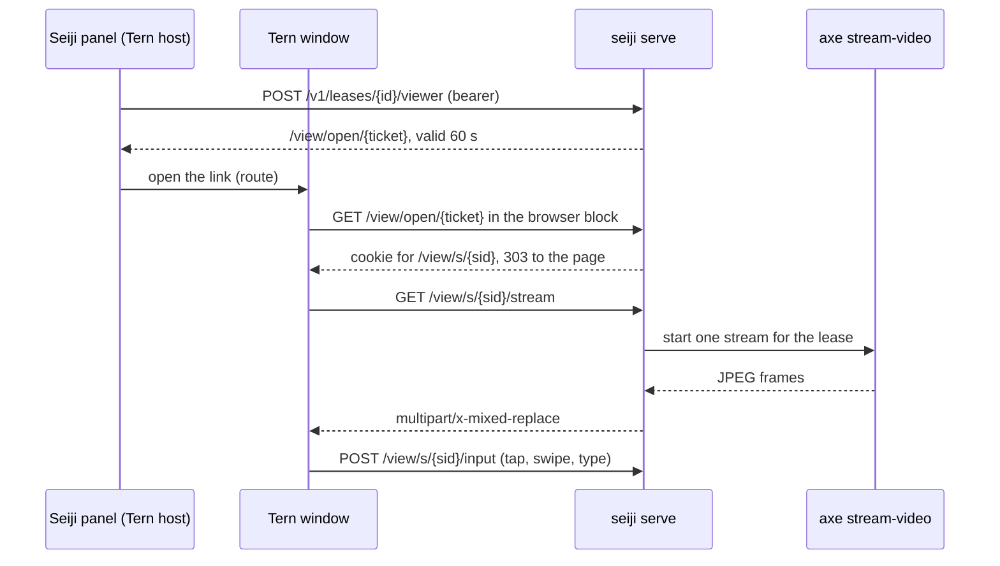

# Seiji in Tern

This guide shows how to see and drive your Seiji simulators from [Tern](https://tern.sh). The Seiji plugin adds a panel with your budget, your devices and your runs. It opens a device's screen in Tern's browser, beside the panel, where you watch it live and tap, swipe and type on it.

## Contents

- [What you get](#what-you-get)
- [Requirements](#requirements)
- [Install](#install)
- [Sign in](#sign-in)
- [The panel](#the-panel)
- [The screen](#the-screen)
- [Links from agents](#links-from-agents)
- [Keys](#keys)
- [Limits](#limits)
- [How it works](#how-it-works)

## What you get

| Where | What |
|---|---|
| Palette | **Seiji: Devices** (⌃⌥D), **Seiji: Runs**, **Seiji: Sign in**, **Seiji: Sign out** |
| Status line | `Seiji · 1 device · 42 min left`; amber under 25 % of your minutes, red under 10 %. A click opens the panel. |
| Panel, head | Minutes used this month, minutes left, devices held, estimated cost. |
| Panel, Devices | Every device you hold. Open its screen, float it, take a screenshot, copy a view-only link, release it, or boot a new one. |
| Panel, Runs | Your recorded runs, with the Markdown summary inline. Copy it for a pull request or download `evidence.zip`. |
| Screen | The simulator, live, in Tern's browser. Click to tap, drag to swipe, type to type. |

## Requirements

- Tern desktop. Browser blocks exist only there, not in Tern web or the iOS app.
- The `seiji` CLI on the Mac that runs Tern. It holds your token in the macOS keychain; the plugin asks it for the token and keeps it in memory only.
- A Seiji server you can reach, and a token from its admin (`seiji user add`).
- The screen works for iOS simulators. Android devices show in the panel but have no live screen yet.

## Install

From a clone of this repository:

```sh
cargo install --path .            # the seiji CLI
tern plugin link tern-plugin      # use the plugin where it is
```

Or without a clone:

```sh
tern plugin install github.com/wiljafor1/seiji/tern-plugin
```

Tern started from the Dock may not have `~/.cargo/bin` on its PATH. Then set `SEIJI_BIN` to the CLI's path in the environment Tern starts with, or link the binary into `/usr/local/bin`.

## Sign in

Run **Seiji: Sign in** from the palette, or press enter in the panel. Enter the server's URL. Tern opens a tab that runs `seiji login --url <server>`, which asks for your token without echoing it. The panel picks up the sign-in by itself within a few seconds.

In a terminal:

```sh
seiji login --url https://seiji.example.com    # paste the token, then enter
seiji token print --json                        # what the plugin reads
seiji logout
```

`SEIJI_URL` and `SEIJI_TOKEN` override the keychain, for CI and tests.

## The panel

The panel polls `budget_status` every 3 s and `list_runs` every 10 s while the Runs tab is open. Each device row shows its model, its lease and when it ends. The detail card beside the list says when Seiji releases it: at the latest at the lease's maximum length, or after the idle time with no calls.

- **New device** opens a picker with every model the host offers and how many are free. Booting takes 30-90 s; the row shows the time so far.
- **Screenshot** shows the screen inside the card. A click on the picture zooms it.
- **Share link** copies a view-only viewer link. It opens once, within 60 s.
- **Release** asks first, then deletes the device. Open screens on it close. Runs and their evidence stay.
- In **Runs**, **Copy summary** copies the run's Markdown summary (`export_evidence`). **Download evidence** saves `evidence.zip` to `~/Downloads`. Past 16 MiB, Tern cannot download it; the plugin copies a `curl` command that does.

## The screen

**Open screen** (o) shows the device in Tern's browser beside the panel. **Float** (f) shows it as a picture in picture over the panel instead.

| You do | The device gets |
|---|---|
| Click | A tap where you clicked |
| Hold for 400 ms or more | A long press |
| Drag | A swipe along the drag |
| Scroll the wheel | One swipe per gesture |
| Type | The text, through AXe |
| Enter, Esc, Backspace, Tab, arrows | The matching key |
| Paste (⌘V) | The clipboard's text |
| ⌘⇧H, ⌘L | Home, Lock |
| ⌘S, or **Screenshot** | A JPEG download of the screen |

The dot in the toolbar is green while the stream is live, amber while a run uses the device, and red when the device is gone. While a run holds the device, the screen keeps playing but input waits: a tap answers "A run is using the device" instead of mixing with the run's steps.

A view-only screen shows a **View only** badge and sends no input.

## Links from agents

An agent can call the MCP tool `share_screen` to give you a link to its simulator. The link is view-only unless the agent passes `control: true`. Click it in any Tern pane: the plugin opens it beside that pane. Alt-click floats it. Outside Tern, any browser opens it.

## Keys

| Key | Devices | Runs |
|---|---|---|
| tab | Go to Runs | Go to Devices |
| ↑ ↓ | Select a device | Select a run |
| o, enter | Open the screen | Copy the summary |
| f | Float the screen | |
| s | Screenshot | |
| l | Copy a view-only link | |
| x | Release (asks first) | |
| d | | Download evidence |
| n | New device | New device |
| r | Refresh | Refresh |

## Limits

- iOS simulators only, for the screen.
- One viewer link opens one viewer session. A session lasts `viewer.sessionHours` (12 h by default) and never past its lease. Open the device again from the panel to get a new link.
- A lease takes at most `viewer.maxViewersPerLease` open screens (4 by default).
- Watching a device keeps it from idle release: the stream counts as activity once a minute. It does not stop the maximum lease length.
- Typed text goes through AXe's `type`, with its limits on characters.

## How it works



The token never reaches the browser. The panel uses it to ask for a one-time ticket; the browser trades the ticket for a session cookie scoped to that session's path. Every request checks the session, the user and the lease. For the full model, read [security.md](security.md#the-viewer). For the endpoints, read [mcp.md](mcp.md). For the settings, read [configuration.md](configuration.md#viewer).
