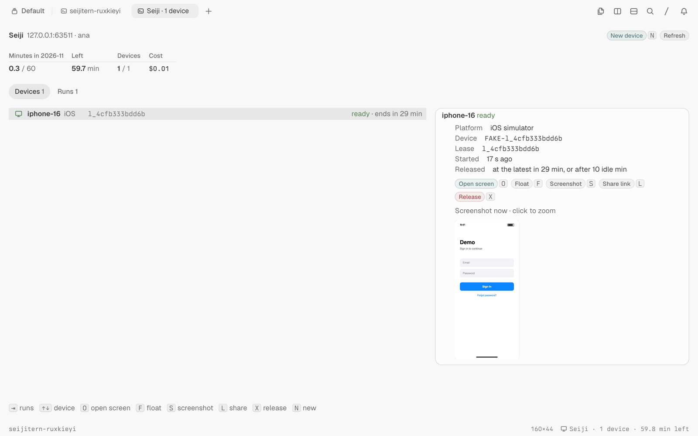
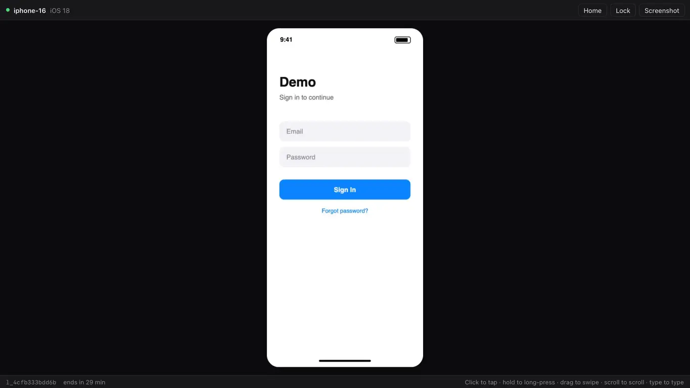
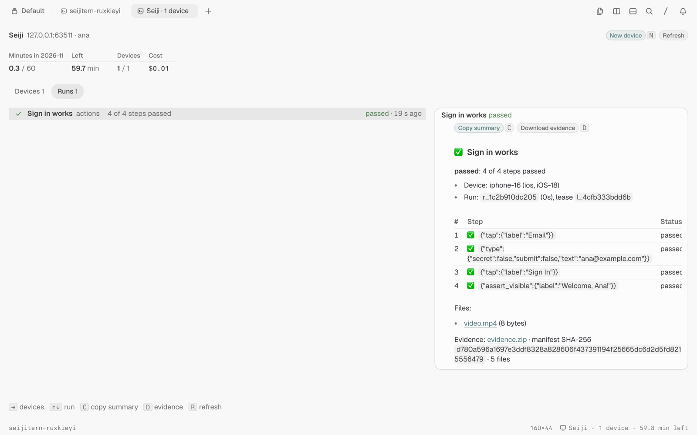

# Seiji in Tern

This guide shows how to see and drive your Seiji simulators from [Tern](https://tern.sh). The Seiji plugin adds a panel with your budget, your devices and your runs. It opens a device's screen in Tern's browser, beside the panel, where you watch it live and tap, swipe and type on it.

## Contents

- [What you get](#what-you-get)
- [Requirements](#requirements)
- [Install](#install)
- [Sign in](#sign-in)
- [Example: check a sign-in screen](#example-check-a-sign-in-screen)
- [The panel](#the-panel)
- [The screen](#the-screen)
- [Links from agents](#links-from-agents)
- [Users (admin)](#users-admin)
- [Keys](#keys)
- [Limits](#limits)
- [How it works](#how-it-works)

## What you get

| Where | What |
|---|---|
| Palette | **Seiji: Devices** (⌃⌥D), **Seiji: Runs**, **Seiji: Sign in**, **Seiji: Sign out** |
| Status line | `Seiji · 1 device · 42 min left`; amber under 25 % of your minutes, red under 10 %. Shows `Unlimited` when the monthly budget is unlimited. A click opens the panel. |
| Panel, head | Minutes used this month, minutes left (or **Unlimited**), devices held, estimated cost. |
| Panel, Devices | Every device you hold. Open its screen, float it, take a screenshot, copy a view-only link, release it, or boot a new one. |
| Panel, Runs | Your recorded runs, with the Markdown summary inline. Copy it for a pull request or download `evidence.zip`. |
| Screen | The simulator, live, in Tern's browser. Click to tap, drag to swipe, type to type. |

## Requirements

- Tern desktop. Browser blocks exist only there, not in Tern web or the iOS app.
- The `seiji` CLI on the Mac that runs Tern. It holds your token in the macOS keychain; the plugin asks it for the token and keeps it in memory only.
- A Seiji server you can reach, and a token from its admin (`seiji user add`).
- The screen works for iOS simulators. Android devices show in the panel but have no live screen yet.

## Install

You need Rust (`rustup`) and Tern desktop on your Mac. No clone is needed.

**1. Install the `seiji` CLI.** It signs you in and keeps your token in the keychain. The plugin asks it for the token.

```sh
cargo install --git https://github.com/orbi-edu/seiji
seiji --version
```

**2. Install the plugin.**

```sh
tern plugin install github.com/orbi-edu/seiji/tern-plugin
tern plugin list            # seiji 0.4.0 Seiji — 1 blocks, 0 lenses, window  ready
```

Tern loads it at once; no restart. This installs the plugin from `main`.

To install the plugin of a release instead, take its `seiji-tern-plugin-<tag>.tar.gz` from the [releases](https://github.com/orbi-edu/seiji/releases) (each release carries one, with a `.sha256` file), unpack it and install the `seiji` folder:

```sh
gh release download v0.4.0 --repo orbi-edu/seiji --pattern 'seiji-tern-plugin-*'
shasum -a 256 -c seiji-tern-plugin-v0.4.0.tar.gz.sha256
tar -xzf seiji-tern-plugin-v0.4.0.tar.gz
tern plugin install ./seiji --force
```

The workflow attaches the plugin only when the release's tag matches `version` in `tern-plugin/plugin.toml` (`v0.4.0` for `0.4.0`). Otherwise it fails, and the release has no plugin: bump the version before you tag.

**3. Let Tern find the CLI.** The plugin checks `SEIJI_BIN`, then `$CARGO_HOME/bin/seiji` (or `~/.cargo/bin/seiji`), then `PATH`. Tern started from the Dock may not have `~/.cargo/bin` on its PATH; since Cargo installs to `~/.cargo/bin` by default, the plugin finds it there without extra setup. If it still says *The seiji CLI is missing*, set the path explicitly and start Tern again:

```sh
launchctl setenv SEIJI_BIN "$HOME/.cargo/bin/seiji"
```

To work on the plugin itself, use the copy in a clone instead: `tern plugin link tern-plugin` from the repository's root. Tern then reads the files where they are. `tern plugin remove seiji` (installed) or `tern plugin unlink seiji` (linked) takes it out.

## Sign in

Run **Seiji: Sign in** from the palette, or press enter in the panel. Enter the server's URL. Tern opens a tab that runs `seiji login --url <server>`, which asks for your token without echoing it. The panel picks up the sign-in by itself within a few seconds.

In a terminal:

```sh
seiji login --url https://seiji.example.com    # paste the token, then enter
seiji token print --json                        # what the plugin reads
seiji logout
```

`SEIJI_URL` and `SEIJI_TOKEN` override the keychain, for CI and tests.

## Example: check a sign-in screen

This example walks through a typical session. You boot an iPhone, try the sign-in screen by hand, then let an agent record the same check as a run with evidence. The pictures come from Seiji's test harness, which uses a fake simulator.

**1. Open the panel.** Press ⌃⌥D, or run **Seiji: Devices** from the palette. The head shows your minutes this month.

**2. Boot a device.** Press `n` and pick `iphone-16`. The row counts the seconds while it boots (30-90 s). When it says `ready`, install your app the usual way, for example by asking your agent to call `install_app`, or run your dev server through `seiji forward` ([apps.md](apps.md)).

**3. Look at it.** Press `s`. A screenshot appears in the device card.



**4. Drive it.** Press `o`. The screen opens in Tern's browser beside the panel. Click **Email** and type an address, click **Password** and type, then click **Sign In**. Press `f` instead of `o` to float the screen over the panel while you work in another pane.



**5. Let an agent record it.** In an agent pane (Claude Code, Codex, omp) connected to Seiji's MCP endpoint, ask:

```text
Call share_screen on my Seiji iPhone so I can watch. Then run_actions named
"Sign in works": tap "Email", type "ana@example.com", tap "Sign In", and
assert "Welcome, Ana!" is visible.
```

The agent prints a viewer link. Click it in the agent's pane: the screen opens beside that pane, and you watch the steps as they run. The link is view-only unless the agent passes `control: true`.

**6. Use the evidence.** Press `tab` for **Runs**. The run's summary shows in its card: the verdict, every step and the files. Press `c` to copy the Markdown for your pull request, or `d` to save `evidence.zip` to `~/Downloads`.



**7. Release the device.** Back in **Devices**, press `x`, then enter. The device stops counting against your minutes. The run and its evidence stay.

## The panel

The panel polls `budget_status` every 3 s and `list_runs` every 10 s while the Runs tab is open. Each device row shows its model, its lease and when it ends. The detail card beside the list says when Seiji releases it: at the latest at the lease's maximum length, or after the idle time with no calls.

- **New device** opens a picker with every model the host offers and how many are free. Booting takes 30-90 s; the row shows the time so far.
- **Screenshot** shows the screen inside the card. A click on the picture zooms it.
- **Share link** copies a view-only viewer link. It opens once, within 60 s.
- **Release** asks first, then deletes the device. Open screens on it close. Runs and their evidence stay.
- In **Runs**, **Copy summary** copies the run's Markdown summary (`export_evidence`). **Download evidence** saves `evidence.zip` to `~/Downloads`. Past 16 MiB, Tern cannot download it; the plugin copies a `curl` command that does.

## The screen

**Open screen** (o) shows the device in Tern's browser beside the panel. **Float** (f) shows it as a picture in picture over the panel instead.

| You do | The device gets |
|---|---|
| Click | A tap where you clicked |
| Hold | A long press, as long as you hold |
| Drag | A finger that follows the pointer while you drag: lists scroll and pages turn under it |
| Drag from the bottom edge | The home gesture (Face ID devices) |
| Scroll the wheel or trackpad | A drag along the scroll, lifted when you stop |
| Type | The keys, as a hardware keyboard with a US layout. Characters that layout has no key for (accents, emoji) are pasted |
| Enter, Esc, Backspace, Tab, Delete, arrows, Home, End | The matching key |
| ⌘A, ⌘C, ⌘X, ⌘Z | The same shortcut on the device |
| Paste (⌘V) | The clipboard's text |
| ⌘⇧H, ⌘L | Home, Lock |
| ⌘S, or **Screenshot** | A JPEG download of the screen |
| ⌥I, or **Stats** | The stream's fps, bitrate, round trip, jitter and frame age |

The screen is H.264 video decoded in the browser (WebCodecs), up to 30 frames a second. Your input shows at once, before the device answers: a dot where your finger is, its path as you drag, and a ripple where a tap landed. On a slow link the picture skips frames rather than falling behind, and the bitrate drops until the link recovers. A swipe that the link delayed still reaches the device with its own speed ([mcp.md](mcp.md#gesture-timing)).

When the host has WebRTC on ([configuration.md](configuration.md#webrtc)) and can be reached over UDP, the picture and your input go over WebRTC instead, and **Stats** shows `Transport: WebRTC (UDP)`. When WebRTC cannot connect, the page stays on the WebSocket without a word.

The badge next to the device name shows the link: its round trip and jitter, and the share of frames lost on the way (`3% lost`). It is green when the link is good, amber when it is fair, red when it is poor or stalled (`no answer 4 s`). When it stays red, the page says so; pick **Smooth** to need less bandwidth.

The dot in the toolbar is green while the stream is live, amber while a run uses the device, and red when the device is gone. While a run holds the device, the screen keeps playing but input waits: a tap answers "A run is using the device" instead of mixing with the run's steps.

A view-only screen shows a **View only** badge and sends no input.

## Links from agents

An agent can call the MCP tool `share_screen` to give you a link to its simulator. The link is view-only unless the agent passes `control: true`. Click it in any Tern pane: the plugin opens it beside that pane. Alt-click floats it. Outside Tern, any browser opens it.

## Users (admin)

When the signed-in user is a Seiji admin (listed in `adminUsers` in [configuration.md](configuration.md)), the panel adds a **Users** tab beside Devices and Runs.

The Users tab lists every Seiji user with their name, active devices, budget, admin and disabled state. Select a user to see their detail card: status, admin flag, used minutes, session and idle limits, host capacity, and the devices the user holds now.

Each ready iOS device in the card has three actions:

- **Watch** opens a view-only screen beside the panel.
- **Control** opens the screen with control. Your taps and typing reach the user's device as that user.
- **Copy link** copies a view-only viewer link. It opens once, within 60 s.

These links come from `POST /v1/admin/leases/{lease_id}/viewer` ([mcp.md](mcp.md#post-v1adminleaseslease_idviewer)). Seiji logs each one. The user is not told ([security.md](security.md#the-viewer)).

Press `e` (or click **Edit**) to edit the selected user's limits:

- **Max devices**: the number of devices this user may hold at once. Use the −/+ steppers; minimum 1. Lowering the limit blocks new acquisitions but does not evict already-held devices.
- **Unlimited monthly budget**: a toggle. When on, the monthly budget is not enforced, but minutes continue to be metered. The saved numeric budget is preserved and shown read-only for switching back.
- **Monthly minutes**: the numeric budget. Use the ±60 / ±600 steppers to adjust. Only editable when unlimited is off. Reducing the budget can end leases on the next reaper pass.

Press `enter` (or click **Save**) to persist the changes, or `esc` (or click **Cancel**) to discard them. While saving, edits and cancel are locked. The plugin shows a validation error for invalid inputs and a server error when the save fails. A successful save re-fetches authoritative data from the server.

Session duration and idle release are set by the operator through the CLI, not from the panel.

The Users tab also has a **Viewer settings** card, to try settings without a restart:

- **Gesture pacing, at most**: the longest a swipe's points wait to keep the swipe's speed (`viewer.paceMaxMs`). Use −20/+20; 0–1000 ms.
- **WebRTC on / off**: whether newly opened viewers may use WebRTC. It can be turned on only when `seiji.json` sets its ports and an address; otherwise the card says why.
- **Trace on / off**: the [viewer trace](mcp.md#the-viewer-trace), every input and frame of every viewer as a JSON line, with timings only. Turning it on starts a new trace. Once there is one, the card shows its size and **Download trace** saves it to `~/Downloads/seiji-viewer-trace.jsonl` (past 16 MiB, the plugin copies a `curl` command that does).

Each click saves at once (`PUT /v1/admin/viewer`, [mcp.md](mcp.md#get-v1adminviewer-put-v1adminviewer)). The card shows the `seiji.json` value next to each setting; a restart goes back to it and turns the trace off.

Non-admin users do not see the Users tab or any admin data. The server enforces permission on every admin request regardless of what the UI shows.

## Keys

| Key | Devices | Runs | Users |
|---|---|---|---|
| tab | Go to Runs | Go to Users (admin) or Devices | Go to Devices |
| ↑ ↓ | Select a device | Select a run | Select a user |
| o, enter | Open the screen | Copy the summary | Edit / Save |
| f | Float the screen | | |
| s | Screenshot | | |
| l | Copy a view-only link | | |
| x | Release (asks first) | | |
| d | | Download evidence | |
| e | | | Edit user |
| esc | | | Cancel edit |
| n | New device | New device | |
| r | Refresh | Refresh | Refresh |

## Limits

- iOS simulators only, for the screen.
- One viewer link opens one viewer session. A session lasts `viewer.sessionHours` (12 h by default) and never past its lease. Open the device again from the panel to get a new link.
- A lease takes at most `viewer.maxViewersPerLease` open screens (4 by default).
- Watching a device keeps it from idle release: the stream counts as activity once a minute. It does not stop the maximum lease length.
- Pasted and typed text goes through AXe (about a second); the screen's keys go through Seiji's HID connection at once.
- The browser must support WebCodecs: Tern, and current Chrome, Edge, Safari and Firefox do.

## How it works

```mermaid
sequenceDiagram
    participant P as Seiji panel (Tern host)
    participant W as Tern window
    participant S as seiji serve
    participant A as seiji-sim
    P->>S: POST /v1/leases/{id}/viewer (bearer)
    S-->>P: /view/open/{ticket}, valid 60 s
    P->>W: open the link (route)
    W->>S: GET /view/open/{ticket} in the browser block
    S-->>W: cookie for /view/s/{sid}, 303 to the page
    W->>S: WebSocket /view/s/{sid}/ws
    S->>A: start one helper for the lease
    A-->>S: H.264 frames
    S-->>W: frames (W acknowledges each one)
    W->>S: touch down, move, up; keys; text
    S->>A: touches and keys on its HID connection
```

The token never reaches the browser. The panel uses it to ask for a one-time ticket; the browser trades the ticket for a session cookie scoped to that session's path. Every request checks the session, the user and the lease. For the full model, read [security.md](security.md#the-viewer). For the endpoints, read [mcp.md](mcp.md). For the settings, read [configuration.md](configuration.md#viewer).

The plugin's MCP tool calls (acquire, release, budget, runs, models) work with both `application/json` and `text/event-stream` responses, so the plugin is compatible with servers that stream MCP over SSE.
